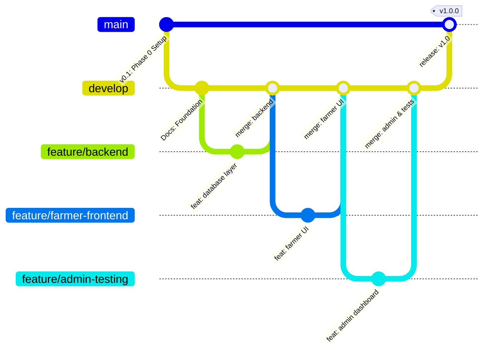

# Team Development Workflow & Collaboration Guidelines
## Soil Testing Appointment & Report Access Portal

---

## 1. Team Responsibility Matrix

To prevent merge conflicts and ensure clear ownership, responsibilities are cleanly divided among the three team members:

| Team Member | Core Focus Area | Primary Directories / Files | Responsibilities |
| :--- | :--- | :--- | :--- |
| **Person 1** | **Backend & Database** | `app/`, `instance/`, `tests/test_db.py`, `tests/test_health.py` | Database schema, connection management, Flask API routes, business logic, query optimization, and backend tests. |
| **Person 2** | **Farmer Frontend** | `app/templates/farmer/`, `app/static/js/farmer/`, `app/static/css/` | Farmer user interface, responsive booking forms, appointment listing view, report download trigger, client-side validation. |
| **Person 3** | **Admin Module, QA & Security** | `app/templates/admin/`, `app/static/js/admin/`, `tests/`, `docs/` | Admin dashboard UI, status management views, PDF upload drag-and-drop, automated security test suites, and documentation maintenance. |

---

## 2. Git Branching Strategy

The repository follows a trunk-based feature branch workflow centered around `main` and `develop`.



### 2.1 Branch Conventions
- **`main`**: Production-ready, fully tested releases. Direct commits are forbidden.
- **`develop`**: Central integration branch. All completed features are merged here.
- **`feature/backend`**: Person 1's active branch for backend endpoints and database services.
- **`feature/farmer-frontend`**: Person 2's active branch for farmer views, styles, and scripts.
- **`feature/admin-testing`**: Person 3's active branch for administrative screens, end-to-end tests, and security audits.

---

## 3. Git Commit Message Guidelines

All team members must adhere to the **Conventional Commits** standard:

```text
<type>(<scope>): <short description in present imperative tense>

[optional body explaining WHY the change was made]
```

### Commit Types:
- `feat`: A new user-facing feature or API endpoint.
- `fix`: A bug fix.
- `docs`: Documentation changes or additions.
- `test`: Adding or updating tests without changing production code.
- `refactor`: Code changes that neither fix a bug nor add a feature.
- `chore`: Maintenance tasks, dependencies, or `.gitignore` updates.

### Examples:
```text
feat(auth): add farmer registration endpoint with phone validation
test(appointments): add tests for past-date appointment rejection
docs(api): update API contract with report download headers
fix(db): ensure foreign keys are enabled on every connection
```

---

## 4. API Contract Coordination Protocol

To allow Person 2 and Person 3 to build frontends in parallel with Person 1's backend work:

1. **Contract First:** Before implementing any new route, all three teammates must review and agree on the specification in `docs/API_CONTRACT.md`.
2. **Mocking Data:** Person 2 and Person 3 can mock the agreed JSON responses locally in frontend JavaScript while Person 1 completes the backend implementation.
3. **Zero Undocumented Breaking Changes:** If Person 1 needs to modify a field name (e.g. changing `land_details` to `field_description`), Person 1 must:
   - Announce the proposed change in advance.
   - Update `docs/API_CONTRACT.md`.
   - Update backend routes and notify Person 2 and Person 3.

---

## 5. Code Review & Merge Process

Before any feature branch is merged into `develop`:
1. **Pull the Latest `develop`:**
   ```bash
   git checkout develop
   git pull origin develop
   git checkout feature/<your-branch>
   git merge develop
   ```
2. **Run the Full Test Suite:**
   ```bash
   python3 -m pytest
   ```
   All tests must pass with 100% success.
3. **Submit a Pull Request (PR):**
   - Provide a clear summary of what was added or fixed.
   - Attach test execution output.
   - Tag at least one other team member for review.
4. **Merge:**
   - Only merge once approved by the reviewer.
   - Never use `git push --force` on `main` or `develop`.

---

## 6. Rules Against Overwriting Teammates' Work

1. **Strict File Ownership:**
   - Person 1 does not alter frontend CSS/HTML files without notifying Person 2 or Person 3.
   - Person 2 and Person 3 do not modify `app/db.py` or database schemas directly; database changes are requested from Person 1.
2. **Conflict Resolution:**
   - If a merge conflict occurs, the two developers involved must resolve it collaboratively.
   - Never resolve a conflict by blindly choosing "Accept Theirs" or "Accept Mine".
   - Test suite must be executed immediately following conflict resolution.

