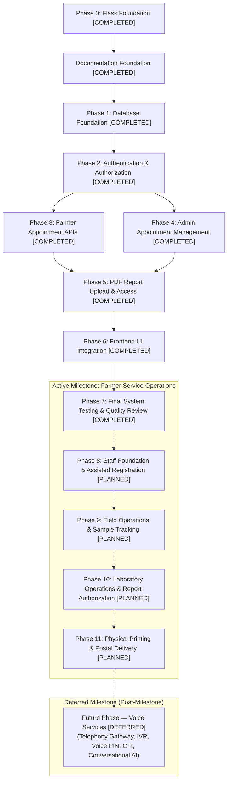

# Phased Implementation Plan & Roadmap
## Soil Testing Appointment & Report Access Portal

---

## 1. Project Implementation Roadmap

---

## 2. Phase-by-Phase Breakdown

### Phase 0: Flask Foundation
- **Status:** **COMPLETED**
- **Deliverables:**
  - Application factory in `app/__init__.py`.
  - Health check endpoint `GET /api/health` in `app/routes.py`.
  - Entry point `run.py`.
  - Pytest configuration and initial test suite (`tests/test_health.py`).
  - `.gitignore`, `requirements.txt`, and `README.md`.
- **Exit Criteria:** Health endpoint returns HTTP 200 with JSON payload; all tests pass.

---

### Documentation Foundation
- **Status:** **COMPLETED**
- **Deliverables:**
  - Comprehensive documentation suite under `docs/`:
    - `PROJECT_OVERVIEW.md`
    - `REQUIREMENTS.md`
    - `SYSTEM_ARCHITECTURE.md`
    - `DATABASE_DESIGN.md`
    - `API_CONTRACT.md`
    - `SECURITY.md`
    - `TESTING.md`
    - `DEVELOPMENT_WORKFLOW.md`
    - `IMPLEMENTATION_PLAN.md`
    - `INTERVIEW_PREPARATION.md`
- **Exit Criteria:** All core documentation files created and aligned with architectural guidelines.

---

### Phase 1: Database Foundation
- **Status:** **COMPLETED**
- **Dependencies:** Phase 0, Documentation Foundation.
- **Deliverables:**
  - `app/schema.sql`: DDL for `users`, `appointments`, and `reports` tables, constraints, check conditions, foreign keys (`ON DELETE RESTRICT`), and performance indexes.
  - `app/db.py`: Database connection helpers (`get_db`, `close_db`, `init_db`), WAL configuration, foreign key pragma, busy timeout, `flask init-db` CLI command, and `flask init-admin` CLI command with interactive hidden password prompt.
  - `tests/test_db.py`: Comprehensive test suite verifying initialization, table creation, constraints, foreign keys, transaction rollback, connection teardown, and admin provisioning.
- **Exit Criteria:** 23 automated database tests pass with 100% success; database tables created in `instance/soil_testing.db`.

---

### Phase 2: Authentication & Authorization
- **Status:** **COMPLETED**
- **Dependencies:** Phase 1.
- **Deliverables:**
  - `app/auth.py`: Blueprint implementing `POST /api/auth/register`, `POST /api/auth/login`, `POST /api/auth/logout`, `GET /api/auth/me`, and `GET /api/auth/csrf-token`.
  - Authorization decorators in `app/auth.py`: `@login_required`, `@admin_required`, and `@farmer_required` with live database role verification.
  - Double-submit CSRF protection hook in `app/auth.py` validating state-changing requests (`POST`, `PUT`, `PATCH`, `DELETE`).
  - Secure session cookie configuration in `app/__init__.py` (`HttpOnly=True`, `SameSite='Lax'`, `Secure=True` in production).
  - `tests/test_auth.py`: 24 automated unit and integration tests covering CSRF, registration, login, session lifecycle, role reload from DB, and authorization decorators.
- **Exit Criteria:** All 24 authentication tests pass (49 tests total across project); manual verification of all 9 auth scenarios verified with 100% success.

---

### Phase 3: Farmer Appointment Functionality
- **Status:** **COMPLETED**
- **Dependencies:** Phase 2.
- **Deliverables:**
  - `app/appointments.py`: Blueprint implementing `POST /api/appointments`, `GET /api/appointments`, and `GET /api/appointments/<int:appointment_id>`.
  - Registered `appointments_bp` in `app/__init__.py`.
  - Strict input validation: `land_details` (1-500 chars), `address` (1-500 chars), `preferred_date` (`YYYY-MM-DD`, valid calendar date, not in past), `preferred_time` (`09:00-12:00` or `14:00-17:00`), `notes` (optional, max 1000 chars).
  - Security & Ownership: Authenticated farmer identity used for `farmer_id`; client-provided `farmer_id` or `status` ignored; initial status hardcoded to `Pending`; anti-IDOR `404 Not Found` returned on missing or cross-tenant appointment lookups; CSRF protection enforced on `POST`.
  - Transactionality & Concurrency: Parameterized queries within atomic transactions (`with get_db():`). Documented duplicate request semantics.
  - `tests/test_appointments.py`: 18 automated unit, integration, and security tests covering creation, validation, ownership, listing, IDOR defense, and RBAC.
- **Exit Criteria:** All 18 appointment tests pass (67 tests passing across suite); 12/12 manual verification steps verified successfully; development database contains 0 test records.

---

### Phase 4: Admin Appointment Management
- **Status:** **COMPLETED**
- **Dependencies:** Phase 2, Phase 3.
- **Deliverables:**
  - `app/admin.py`: Blueprint implementing `GET /api/admin/appointments`, `GET /api/admin/appointments/<int:id>`, and `PATCH /api/admin/appointments/<int:id>/status`.
  - Registered `admin_bp` in `app/__init__.py`.
  - Admin listing route supporting `?status=` filter (`Pending`, `Approved`, `Rejected`, `Completed`) and bounded pagination (`page`, `per_page` up to 100).
  - Admin single appointment detail route with joined farmer information and exclusion of password hashes.
  - Admin status transition route enforcing state machine (`Pending` -> `Approved`/`Rejected`; `Approved` -> `Completed`; terminal states; same-status no-op; explicit `updated_at = CURRENT_TIMESTAMP`).
  - Atomic conditional update preventing concurrent update overwrite collisions.
  - Timezone improvement in `app/appointments.py` validating dates against `Asia/Kolkata`.
  - `tests/test_admin_appointments.py`: 32 automated unit, integration, and security tests.
- **Exit Criteria:** All 32 admin tests pass (99 tests total across suite); 12/12 manual verification steps verified successfully; development database contains 0 test records.

---

### Phase 5: PDF Report Upload and Access
- **Status:** **COMPLETED**
- **Dependencies:** Phase 4.
- **Deliverables:**
  - `app/reports.py`: Blueprint implementing `POST /api/admin/appointments/<id>/report`, `GET /api/appointments/<id>/report`, `GET /api/appointments/<id>/report/download`, `GET /api/admin/appointments/<id>/report`, and `GET /api/admin/appointments/<id>/report/download`.
  - Registered `reports_bp` in `app/__init__.py`.
  - Admin report upload route requiring `Completed` status and enforcing 1 report per appointment limit.
  - Streaming file validation: 10 MB limit, `%PDF-` signature check, `%%EOF` end-of-file marker check, MIME type verification.
  - Staged temporary write, SHA-256 computation, and atomic `os.replace` to UUID4 physical filename (`<uuid4>.pdf`).
  - Storing relative storage basename in `reports` table; never exposing server paths in API responses.
  - Atomic cleanup of staging and target files on database failure or constraint collision.
  - Farmer metadata and download routes strictly scoped to owned completed appointments with anti-IDOR safe 404s.
  - Admin metadata and download routes for administrative audit.
  - Security headers: `X-Content-Type-Options: nosniff`, `Cache-Control: private, no-cache, no-store, must-revalidate`.
  - Extended CSRF validation to support multipart form uploads.
  - `tests/test_reports.py`: 42 automated unit, integration, failure-injection, concurrency, payload-size, and security tests.
- **Exit Criteria:** All 42 report tests pass (141 tests total across suite); manual verification of failure recovery, concurrency, and request limits verified successfully; development database and storage directory contain 0 test records.

---

### Phase 6: Frontend Integration
- **Status:** **COMPLETED**
- **Dependencies:** Phases 2, 3, 4, 5.
- **Deliverables:**
  - `app/views.py`: HTML view routing blueprint for `/`, `/register`, `/login`, `/farmer`, `/admin` with server-side authentication and role-based redirects.
  - `app/templates/`: Jinja2 templates (`base.html`, `index.html`, `register.html`, `login.html`, `farmer.html`, `admin.html`) with XSS-resilient text rendering and global alerts.
  - `app/static/css/style.css`: Responsive mobile-first CSS with dedicated `@media (max-width: 640px)` and `@media (max-width: 380px)` rules preventing horizontal overflow across 360px, 390px, 768px, and 1366px viewports.
  - `app/static/js/api.js`: Reusable API client with in-memory CSRF caching, session verification, multipart upload handling, binary PDF downloading, and 401 session expiration handling.
  - `app/static/js/farmer.js`: Farmer dashboard, Asia/Kolkata date validation, booking form, appointment list, and report download with strict HTML escaping.
  - `app/static/js/admin.js`: Admin dashboard, appointment queue with status filters and pagination, state machine actions, and PDF upload with strict HTML escaping and DOM sanitization.
  - `tests/test_views.py`: 11 automated unit, security, and end-to-end integration tests.
- **Exit Criteria:** All 11 frontend tests pass (152 tests total across suite with 100% pass rate); real browser automation fully verified; development database and storage directory contain 0 test records.

---

### Phase 7: Final System Testing, Quality Review and Documentation
- **Status:** **COMPLETED**
- **Dependencies:** Phase 6.
- **Deliverables:**
  - Comprehensive end-to-end browser verification via headless Google Chrome over Chrome DevTools Protocol (CDP) for the complete Farmer Workflow (18 steps) and Admin Workflow (21 steps).
  - Responsive layout validation across 360px, 390px, 768px, and 1366px viewports with zero horizontal overflow.
  - Role and authorization boundary testing (unauthenticated 401, farmer-on-admin 403, admin-on-farmer 403).
  - Fresh setup verification from scratch (virtualenv, `pip install -r requirements.txt`, `flask init-db`, `flask init-admin`, server launch, and `/api/health` response).
  - Security review across password hashing, signed cookies, CSRF tokens, SQLi prevention, IDOR isolation, XSS DOM sanitization, streaming limits, error masking, and debug mode suppression.
  - Complete technical interview preparation guide (`docs/INTERVIEW_PREPARATION.md`) covering all 18 core technical topics, team role breakdown, and 10 common interview questions.
  - Full automated regression test suite passing: 152 automated tests with 100% pass rate.
  - Database and storage cleanliness: `instance/soil_testing.db` contains 0 rows across all tables; `instance/reports/` contains 0 orphan files.
- **Exit Criteria:** 100% test pass rate across 152 automated tests, zero security vulnerabilities, complete documentation synchronization, clean development state, and project completion.

---

## 3. Active Implementation Milestone: Farmer Service Operations

### Phase 8: Staff Foundation and Assisted Registration
- **Status:** **PLANNED (Next Active Phase)**
- **Dependencies:** Phase 7.
- **Architectural Reference:** `docs/OPERATIONAL_WORKFLOW_DESIGN.md`.
- **Planned Scope & Deliverables:**
  - Transactional maintenance SQLite migration script (`migrate_phase8.py`) with atomic `.bak` backup, adding staff roles (`operator`, `field_worker`, `lab_staff`) and reconciling appointment `Cancelled` status.
  - Creation of `farmer_delivery_addresses` table for separate home postal destinations.
  - Passwordless assisted registration flow for operators creating farmer records without plaintext password exposure.
  - Web account claim / activation workflow via SMS OTP.
  - Granular RBAC decorators (`@operator_required`, `@field_worker_required`, `@lab_staff_required`).
  - Immutable operator audit logging (`operator_audit_logs`).
  - Admin-only staff account provisioning.
  - Dedicated automated test suite covering new roles, permissions, address separation, and assisted onboarding.

---

### Phase 9: Field Operations and Sample Tracking
- **Status:** **PLANNED**
- **Dependencies:** Phase 8.
- **Architectural Reference:** `docs/OPERATIONAL_WORKFLOW_DESIGN.md`.
- **Planned Scope & Deliverables:**
  - Creation of `field_visits` and `soil_samples` tables.
  - Field worker assignment by administrators and sector-based dispatch tracking (`Assigned`, `En Route`, `Completed`, `Missed`).
  - Standardized barcode sample tagging (`SMP-YYYY-XXXX`) and custody logging (`Collected`, `In Transit`, `Received`).
  - Optional GPS telemetry capture with robust fallback to survey numbers and textual landmarks.
  - Strict data minimization: field workers view only land location and field notes, with zero access to home delivery addresses.
  - Automated concurrency and state transition test suite for field visits.

---

### Phase 10: Laboratory Operations and Report Authorization
- **Status:** **PLANNED**
- **Dependencies:** Phase 9.
- **Architectural Reference:** `docs/OPERATIONAL_WORKFLOW_DESIGN.md`.
- **Planned Scope & Deliverables:**
  - Creation of `lab_test_assays` table.
  - Laboratory blind testing protocol: technicians test anonymous sample codes without viewing farmer identities.
  - Quantitative chemical assay entry (pH, EC, Organic Carbon, Available N, P, K) with institutional parameter calibrations.
  - Scientific report authorization gate requiring certified sign-off prior to PDF publication.
  - Automated PDF report compilation, SHA-256 calculation, and digital publication via existing private report storage.
  - Automated unit and integration test suite covering laboratory assays and scientific verification gates.

---

### Phase 11: Physical Printing and Postal Delivery
- **Status:** **PLANNED**
- **Dependencies:** Phase 10.
- **Architectural Reference:** `docs/OPERATIONAL_WORKFLOW_DESIGN.md`.
- **Planned Scope & Deliverables:**
  - Creation of `report_dispatches` table.
  - Physical print queue for completed, scientifically authorized soil health certificates.
  - Immutable delivery address snapshot preservation frozen at dispatch creation time (`snapshot_recipient_name`, `snapshot_house_details`, `snapshot_pincode`, etc.).
  - Packaging and consignment tracking (`tracking_number`) with India Post Speed Post / registered courier.
  - Postal dispatch status transitions (`Pending Print`, `Printed`, `Dispatched`, `Delivered`, `Returned`).
  - Role-based dispatch management (on-site administrator / dispatch clerk; call-centre operators excluded).
  - End-to-end operational workflow test suite across all decoupled lifecycles (Phases 8–11).

---

## 4. Deferred Milestone: Voice Services (Post-Milestone Phase)

> [!NOTE]
> **Formally Deferred:** Voice assistant and telephony integration features are excluded from active implementation milestones (Phases 8–11). All telephony gateway integrations, IVR menus, Voice PIN authentication, CTI screen-pops, and conversational AI are preserved as design specifications for a dedicated post-launch milestone. The current website's language and authentication functionality remain unchanged.

### Future Phase — Voice Services
- **Status:** **DEFERRED (Post-Milestone)**
- **Dependencies:** Phases 8, 9, 10, 11.
- **Architectural Reference:** `docs/VOICE_ASSISTANT_DESIGN.md`.
- **Deferred Scope:**
  - Cloud telephony gateway integration (PSTN/GSM SIP bridge with Exotel / Twilio / Tata Tele).
  - Bilingual Kannada (kn-IN) and English (en-IN) IVR call flows with DTMF and natural speech recognition.
  - Strict two-factor voice security: Caller ID as lookup hint only, 6-digit Voice PIN, 3-attempt limit, 30-minute lockout, and SMS OTP recovery.
  - Computer Telephony Integration (CTI) screen-pop for operator call transfers.
  - Controlled conversational AI agent with strict agronomic safety guardrails (zero chemical dosage improvisation).
  - Automated outbound status callbacks triggered by backend lifecycle transitions.
