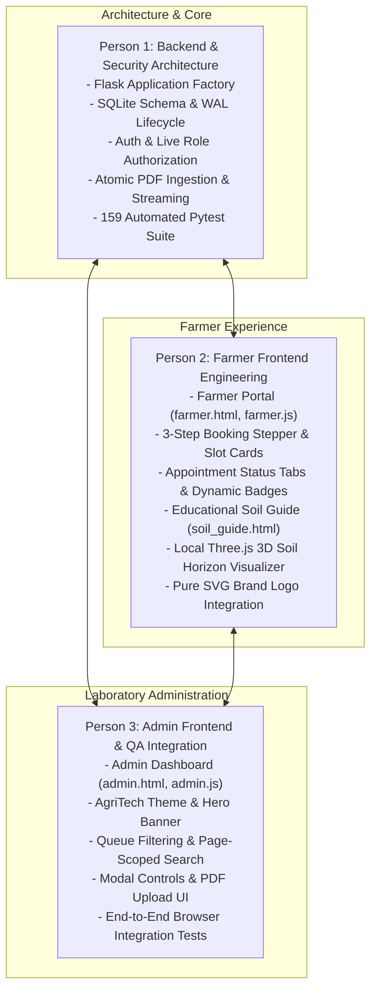

# Comprehensive Technical Interview Preparation Guide
## Soil Testing Appointment & Report Access Portal

---

## Executive Summary & Project Purpose

The **Soil Testing Appointment & Report Access Portal** is a production-grade, secure, full-stack web application designed for agricultural testing laboratories. It bridges the gap between rural farmers and laboratory soil scientists by providing a streamlined, end-to-end digital lifecycle:
1. **Farmers** register, schedule laboratory soil collection appointments with specified crop and land parameters, monitor live testing status, and download cryptographically verified PDF soil health reports.
2. **Laboratory Administrators** review incoming appointment queues, filter by status, manage deterministic appointment state transitions (`Pending` $\rightarrow$ `Approved` / `Rejected` $\rightarrow$ `Completed`), upload tamper-evident PDF soil test analysis certificates, and manage archival records.

The architecture emphasizes **security-first engineering**, **zero-trust role authorization**, **strict tenant isolation (anti-IDOR)**, and **resilient atomic file/database transactions** without unnecessary external framework dependencies.

---

## Team Roles & Contribution Breakdown

In technical interviews, clarity on individual ownership versus collaborative integration is crucial. The project was structured across three specialized roles:



- **Person 1 — Backend & Security Lead:**
  - Designed the Flask application factory (`create_app`), database connection lifecycle, SQLite WAL mode, and foreign key enforcement.
  - Authored the role-based authentication decorators (`@login_required`, `@admin_required`, `@farmer_required`) with live database role verification on every request.
  - Engineered the atomic two-stage PDF upload pipeline (streaming chunk verification $\rightarrow$ UUID private storage $\rightarrow$ atomic database transaction commit $\rightarrow$ rollback orphan cleanup).
  - Built the comprehensive automated testing pyramid comprising 159 unit, integration, failure-injection, and concurrency test cases.
- **Person 2 — Farmer Frontend Engineer:**
  - Implemented the responsive farmer interface (`app/templates/farmer.html`, `app/static/js/farmer.js`).
  - Engineered the 3-step interactive booking stepper with time slot radio cards (`09:00-12:00` and `14:00-17:00`) and comprehensive review confirmation card.
  - Implemented accessible appointment status filter tabs (All, Pending, Approved, Rejected, Completed) with live badge counts and context-specific empty states.
  - Authored the public Soil Health & Testing Guide (`GET /soil-guide`, `app/templates/soil_guide.html`) detailing N-P-K nutrient functions, visual 3-tier pH scale, 5-step sampling protocol, and official agronomic advisory.
  - Integrated the locally hosted Three.js r128 3D soil profile visualizer with layer horizons (O, A, B, C), roots, orbit interaction, and WebGL fallback card.
  - Designed and integrated the pure SVG vector brand logo (`app/static/img/logo.svg`).
- **Person 3 — Admin Frontend & Quality Assurance:**
  - Built the laboratory administrator dashboard (`app/templates/admin.html`, `app/static/js/admin.js`).
  - Integrated the agricultural design palette (`#1B3820`, `#2E7D32`, `#81C784`, `#F4F7F4`, `#E65100`) and the `.admin-hero` administrative banner.
  - Implemented real-time status filtering (All, Pending, Approved, Rejected, Completed), client-side page-scoped appointment search, and server-side pagination controls.
  - Created the modal dialogs for appointment status approval/rejection notes and the multipart PDF file upload widget.
  - Co-developed the cross-origin/same-origin security verifications, DOM XSS protections, and end-to-end headless browser regression test flows.

---

## 18 Core Technical Topics: In-Depth Breakdown

### 1. Project Architecture (Full-Stack Flask + SQLite + Vanilla JS)
- **What it means:** A monolithic, same-origin web architecture where Flask serves both semantic Jinja2 HTML pages and JSON REST API endpoints, backed by SQLite and reactive vanilla JavaScript without heavyweight frontend frameworks.
- **Why the project needs it:** Eliminates frontend build steps (Webpack/Vite/Node modules), prevents CORS complexity, ensures instantaneous page rendering for rural bandwidth, and minimizes deployment footprints.
- **Where it is used:** `app/__init__.py`, `app/views.py`, `app/static/js/api.js`.
- **How it works:** Flask serves server-rendered HTML shells (`/`, `/register`, `/login`, `/farmer`, `/admin`) while the client-side JavaScript (`api.js`) issues asynchronous `fetch` calls to `/api/*` endpoints using signed cookies for authentication.
- **Interview Q&A:**
  - *Q: Why choose vanilla JavaScript over React or Vue for this portal?*
  - *A:* "For an agricultural portal catering to rural environments, minimal asset payload, zero build-step overhead, and maximum browser compatibility were paramount. Vanilla JS with standard DOM APIs allowed us to deliver complete functionality in under 45KB of uncompressed JavaScript, eliminating npm dependency vulnerabilities and client-side hydration delays."

---

### 2. Flask Application Factory Pattern (`create_app`)
- **What it means:** Encapsulating application creation, configuration, blueprint registration, and extension binding inside a callable factory function rather than a global module-level `app` object.
- **Why the project needs it:** Allows instantiating isolated application instances with distinct configurations for production, development, and automated test runners without test state leakage.
- **Where it is used:** [`app/__init__.py`](file:///Users/manojv/Community%20Project/soil-testing-portal/app/__init__.py#L5-L92).
- **How it works:** `create_app(test_config=None)` accepts an optional dictionary. If provided, it overrides default settings (`DATABASE`, `SECRET_KEY`, `TESTING`). The factory registers database hooks (`db.init_app`), security middleware (`verify_csrf_token`), and blueprints (`auth_bp`, `appointments_bp`, `admin_bp`, `reports_bp`, `views_bp`).
- **Interview Q&A:**
  - *Q: What problem does the application factory pattern solve during automated testing?*
  - *A:* "In a global app instance, configuration changes or database connections persist across tests, causing state pollution. With `create_app()`, each test fixture spins up a brand-new application instance pointing to an isolated in-memory or temporary SQLite database, guaranteeing hermetic test execution."

---

### 3. REST APIs & Consistent JSON Response Contracts
- **What it means:** All API endpoints strictly adhere to standard HTTP verbs (`GET`, `POST`, `PUT`, `DELETE`), return explicit HTTP status codes, and maintain a predictable JSON payload envelope.
- **Why the project needs it:** Predictable API structures allow frontend clients and automated tests to handle successes and errors uniformly without special-casing responses.
- **Where it is used:** `app/auth.py` (`error_response`), `docs/API_CONTRACT.md`.
- **How it works:** All success responses return relevant entities or pagination metadata (e.g. `{"appointments": [...], "pagination": {...}}`). All error responses return HTTP 4xx/5xx with `{"error": "Human-readable description"}`.
- **Interview Q&A:**
  - *Q: Why should API error responses never expose internal stack traces or database driver errors?*
  - *A:* "Exposing raw database or runtime exceptions reveals table names, file paths, and library versions, creating information disclosure vulnerabilities (CWE-209). Standardizing on sanitized JSON error messages ensures clients receive actionable guidance while preventing attackers from mapping system internals."

---

### 4. SQLite Schema & Relational Integrity Constraints
- **What it means:** Enforcing data integrity at the database engine level via strict foreign keys, column CHECK constraints, unique indexes, and deletion restrictions (`ON DELETE RESTRICT`).
- **Why the project needs it:** Prevents orphaned child records, invalid status values, malformed phone numbers, or invalid user roles even if application logic encounters bugs.
- **Where it is used:** [`app/schema.sql`](file:///Users/manojv/Community%20Project/soil-testing-portal/app/schema.sql#L1-L75).
- **How it works:** SQLite executes `PRAGMA foreign_keys = ON` on every connection (`app/db.py`). Schema rules enforce:
  - `role IN ('farmer', 'admin')`
  - `status IN ('Pending', 'Approved', 'Rejected', 'Completed')`
  - `UNIQUE(appointment_id)` on `reports` ensuring a 1:1 relationship between completed appointments and PDF reports.
  - `FOREIGN KEY (user_id) REFERENCES users(id) ON DELETE RESTRICT` preventing accidental user deletion while historical appointments exist.
- **Interview Q&A:**
  - *Q: Why use `ON DELETE RESTRICT` instead of `ON DELETE CASCADE` for agricultural testing records?*
  - *A:* "Soil testing reports are legal and compliance documents. If a farmer deletes their account, cascading deletes would destroy historical laboratory records and audit trails. `ON DELETE RESTRICT` enforces regulatory record retention by preventing deletion of entities that have dependent laboratory history."

---

### 5. Authentication & Live Role Authorization
- **What it means:** Authenticating users via secure session cookies and verifying their actual database role in real-time on every privileged API request.
- **Why the project needs it:** Storing roles solely in session cookies exposes the application to stale privilege bugs (e.g., if an administrator deactivates a user or revokes admin privileges, a cached cookie role would allow unauthorized access until logout).
- **Where it is used:** [`app/auth.py`](file:///Users/manojv/Community%20Project/soil-testing-portal/app/auth.py#L32-L78) (`@login_required`, `@admin_required`, `@farmer_required`).
- **How it works:** The decorator extracts `session.get("user_id")`. If missing, it returns HTTP 401. It then queries the database:
  ```python
  user = get_db().execute("SELECT id, role FROM users WHERE id = ?", (user_id,)).fetchone()
  ```
  If the user no longer exists or the role does not match, the session is cleared and HTTP 403 Forbidden is returned.
- **Interview Q&A:**
  - *Q: What is the architectural difference between authentication and authorization in your portal?*
  - *A:* "Authentication verifies *identity* ('Who are you?') via hashed password comparison at `/api/auth/login`. Authorization verifies *permissions* ('Are you allowed to do this?') via our `@admin_required` and `@farmer_required` decorators, which query the database live to confirm the authenticated identity possesses the necessary role to access the specific endpoint."

---

### 6. Cryptographically Signed Session Cookies
- **What it means:** Storing user session identifiers inside Flask's HMAC-SHA256 signed cookie with defensive browser cookie flags (`HttpOnly`, `SameSite='Lax'`, `Secure`).
- **Why the project needs it:** Protects against session hijacking, Cross-Site Scripting (XSS) cookie theft, and Cross-Site Request Forgery (CSRF).
- **Where it is used:** [`app/__init__.py`](file:///Users/manojv/Community%20Project/soil-testing-portal/app/__init__.py#L18-L21).
- **How it works:**
  - `SESSION_COOKIE_HTTPONLY = True`: Blocks client-side JavaScript (`document.cookie`) from reading the session cookie.
  - `SESSION_COOKIE_SAMESITE = "Lax"`: Prevents the cookie from being sent in cross-site `POST`/`PUT`/`DELETE` requests.
  - `SESSION_COOKIE_SECURE = True`: Enforces transmission exclusively over TLS/HTTPS in production environments.
- **Interview Q&A:**
  - *Q: Can a client modify their user_id inside a Flask signed session cookie to impersonate an admin?*
  - *A:* "No. While Flask's default session cookies are serialized with JSON and readable on the client, they are appended with a cryptographic HMAC signature generated using the server's private `SECRET_KEY`. Any tampering with `user_id` invalidates the signature, causing Flask's `SecureCookieSerializer` to reject the cookie and treat the session as empty."

---

### 7. CSRF Protection via In-Memory Double-Submit Tokens
- **What it means:** A state-changing request protection mechanism where a cryptographically secure random token is generated per session, retrieved via `GET /api/auth/csrf-token`, and validated against the session on every mutating request (`POST`, `PUT`, `DELETE`).
- **Why the project needs it:** Prevents malicious third-party websites from tricking an authenticated user's browser into submitting unauthorized actions (e.g., booking unwanted appointments or altering records).
- **Where it is used:** [`app/auth.py`](file:///Users/manojv/Community%20Project/soil-testing-portal/app/auth.py#L81-L125) (`verify_csrf_token`), `app/static/js/api.js`.
- **How it works:**
  1. On session establishment, `secrets.token_hex(32)` is stored in `session["csrf_token"]`.
  2. The frontend fetches the token via `GET /api/auth/csrf-token` and caches it in memory (never in `localStorage`).
  3. Every `POST`/`PUT`/`DELETE` request transmits the token in the `X-CSRF-Token` header.
  4. The `before_request` hook `verify_csrf_token` compares `request.headers.get("X-CSRF-Token")` with `session.get("csrf_token")` using `hmac.compare_digest` to prevent timing attacks.
- **Interview Q&A:**
  - *Q: Why use `hmac.compare_digest` instead of `==` for CSRF token comparison?*
  - *A:* "The standard `==` string equality operator terminates evaluation at the first mismatched character, creating subtle differences in response times. An attacker can exploit these timing variations through statistical analysis to infer the token character by character. `hmac.compare_digest` executes in constant time regardless of where mismatches occur, defeating timing attacks."

---

### 8. SQL Injection Prevention via Parameterized Queries
- **What it means:** Separating executable SQL query structures from user-supplied data parameters using SQLite's native parameter placeholders (`?`).
- **Why the project needs it:** Direct string formatting or interpolation (`f"SELECT * FROM users WHERE name = '{name}'"`) allows attackers to inject arbitrary SQL statements, bypass authentication, or drop tables.
- **Where it is used:** Every database operation in `app/db.py`, `app/auth.py`, `app/appointments.py`, `app/admin.py`, `app/reports.py`.
- **How it works:** The database engine prepares the SQL query plan before binding user input as literal data values:
  ```python
  db.execute("SELECT id, name FROM users WHERE phone = ?", (phone_clean,))
  ```
  Special characters (quotes, semicolons, comments) are treated strictly as string data, never as executable SQL instructions.
- **Interview Q&A:**
  - *Q: Is using an ORM like SQLAlchemy required to prevent SQL injection in Python?*
  - *A:* "No. ORMs prevent SQL injection because they internally use parameterized queries. Native parameterized SQL via SQLite's Python driver (`sqlite3`) provides the exact same mathematical security guarantees against injection while offering complete control over index usage, query optimization, and avoiding ORM bloat."

---

### 9. IDOR Prevention & Multi-Tenant Scoping
- **What it means:** Insecure Direct Object Reference (IDOR) occurs when an application accepts a resource identifier from the user without verifying that the requesting user owns that resource.
- **Why the project needs it:** A farmer should only ever view or download their own appointments and soil test reports. Changing `/api/appointments/5` to `/api/appointments/6` must never expose another farmer's data.
- **Where it is used:** [`app/appointments.py`](file:///Users/manojv/Community%20Project/soil-testing-portal/app/appointments.py#L95-L125), [`app/reports.py`](file:///Users/manojv/Community%20Project/soil-testing-portal/app/reports.py#L225-L265).
- **How it works:** Farmer queries always include `AND user_id = ?` scoped directly to `session["user_id"]`:
  ```python
  appointment = db.execute(
      "SELECT * FROM appointments WHERE id = ? AND user_id = ?",
      (appointment_id, session["user_id"])
  ).fetchone()
  if not appointment:
      return error_response("Appointment not found", 404)
  ```
  Notice it returns a generic 404 instead of 403, preventing resource enumeration.
- **Interview Q&A:**
  - *Q: Why return HTTP 404 instead of HTTP 403 when a farmer attempts to access another farmer's appointment?*
  - *A:* "Returning HTTP 403 reveals that the resource exists, allowing malicious users to probe and enumerate valid IDs across the system (resource enumeration vulnerability). Returning HTTP 404 treats unauthorized access identically to non-existent resources, leaking zero information about the data belonging to other tenants."

---

### 10. Appointment Status Deterministic State Machine
- **What it means:** Modeling appointment lifecycles as a formal state machine with strictly permitted transitions and rejecting all invalid or backward transitions with HTTP 409 Conflict.
- **Why the project needs it:** Prevents administrative errors such as approving an already completed appointment, completing a rejected appointment, or uploading a report for an appointment that was never completed.
- **Where it is used:** [`app/admin.py`](file:///Users/manojv/Community%20Project/soil-testing-portal/app/admin.py#L110-L175).
- **How it works:**
  ```mermaid
  stateDiagram-v2
      [*] --> Pending: Farmer Books Appointment
      Pending --> Approved: Admin Approves
      Pending --> Rejected: Admin Rejects (Requires Reason)
      Approved --> Completed: Admin Completes Testing
      Completed --> [*]: Report Upload Enabled
      Rejected --> [*]: Terminal State
  ```
  Transition rules:
  - `Pending` $\rightarrow$ `Approved` (Valid)
  - `Pending` $\rightarrow$ `Rejected` (Valid with required reason)
  - `Approved` $\rightarrow$ `Completed` (Valid)
  - Any other transition (e.g., `Pending` $\rightarrow$ `Completed` or `Completed` $\rightarrow$ `Pending`) returns HTTP 409 Conflict: `"Cannot transition appointment from '<current>' to '<new>'."`
- **Interview Q&A:**
  - *Q: How does your backend handle concurrency if two administrators simultaneously attempt to approve and reject the same appointment?*
  - *A:* "Status updates execute within an atomic SQLite transaction with immediate write locking (`with get_db():`). The update query checks the expected pre-condition: `UPDATE appointments SET status = ? WHERE id = ? AND status = 'Pending'`. The first transaction succeeds and transitions the row; the second transaction finds zero matching rows with status 'Pending', evaluates the current state, and safely returns HTTP 409 Conflict."

---

### 11. Database Transactions, Context Managers & Rollbacks
- **What it means:** Wrapping multiple interdependent database operations into an atomic unit of work (ACID) using Python's context manager syntax (`with db:`).
- **Why the project needs it:** Ensures that if any failure occurs midway through an operation (e.g., metadata insert fails during a multi-table update), all changes are rolled back automatically, preventing partial database corruption.
- **Where it is used:** [`app/db.py`](file:///Users/manojv/Community%20Project/soil-testing-portal/app/db.py#L35-L65), `app/reports.py`.
- **How it works:**
  SQLite's Python connection acts as a transaction context manager:
  ```python
  with db:
      db.execute("INSERT INTO reports ...")
      db.execute("UPDATE appointments SET status = 'Completed' ...")
  ```
  If any exception occurs inside the block, SQLite automatically issues `ROLLBACK`. If the block exits cleanly, SQLite issues `COMMIT`.
- **Interview Q&A:**
  - *Q: What does SQLite's Write-Ahead Logging (WAL) mode provide for this application?*
  - *A:* "In default rollback journal mode, SQLite locks the entire database file during writes, blocking concurrent readers. We enable `PRAGMA journal_mode = WAL` on connection initialization. In WAL mode, writers append changes to a separate `.db-wal` log file while readers continue reading from the original database snapshot concurrently, drastically improving read throughput and eliminating concurrency lock contention."

---

### 12. Concurrent PDF Upload Protection & Race Conditions
- **What it means:** Preventing two administrators or duplicate requests from uploading conflicting reports for the same appointment at the exact same instant.
- **Why the project needs it:** Simultaneous uploads could lead to orphaned disk files, conflicting file hashes, or database lock timeouts.
- **Where it is used:** [`app/reports.py`](file:///Users/manojv/Community%20Project/soil-testing-portal/app/reports.py#L90-L150).
- **How it works:**
  1. The schema enforces `UNIQUE(appointment_id)` on the `reports` table.
  2. The upload route executes an `IMMEDIATE` transaction check:
     ```python
     existing = db.execute("SELECT id FROM reports WHERE appointment_id = ?", (apt_id,)).fetchone()
     ```
  3. If a record already exists, it immediately aborts with HTTP 409 Conflict: `"A report has already been uploaded for this appointment."`
  4. If a duplicate slips past initial check under race conditions, the SQLite `UNIQUE` constraint triggers an `IntegrityError`, rolling back the transaction and removing the staged PDF file from disk.
- **Interview Q&A:**
  - *Q: How does the application prevent disk file clutter if the database transaction fails after writing the PDF to disk?*
  - *A:* "We employ a two-stage staging and cleanup protocol. The file is written to a temporary staging path during stream validation. Only when validation passes is it moved into private storage. If the subsequent database insert or commit raises any exception, a `try...except` error boundary unlinks the storage file immediately, ensuring zero orphan files remain on disk."

---

### 13. Deep PDF Stream Validation & Magic Bytes
- **What it means:** Inspecting the raw binary byte stream of an uploaded file rather than relying on user-provided MIME types or file extensions.
- **Why the project needs it:** An attacker can easily rename a malicious PHP script, executable, or HTML file to `report.pdf` and send `Content-Type: application/pdf`.
- **Where it is used:** [`app/reports.py`](file:///Users/manojv/Community%20Project/soil-testing-portal/app/reports.py#L40-L85).
- **How it works:**
  1. Validates `MAX_CONTENT_LENGTH = 12 * 1024 * 1024` (12MB total request size) to prevent DoS memory exhaustion.
  2. Enforces a 10MB maximum PDF payload limit.
  3. Reads the first 1024 bytes and verifies the PDF magic header: `bytes_chunk.startswith(b"%PDF-")`.
  4. Streams the remaining bytes in 64KB chunks while maintaining a trailing buffer.
  5. Inspects the final 1024 bytes to confirm the standard PDF trailer end-of-file marker: `b"%%EOF"` exists within the trailer.
- **Interview Q&A:**
  - *Q: Why is inspecting both the header (%PDF-) and the trailer (%%EOF) necessary for PDF validation?*
  - *A:* "Verifying only `%PDF-` at byte zero is easily fooled by prepending `%PDF-` to an executable or shell script (polyglot attack). Verifying both the `%PDF-` header and the trailing `%%EOF` marker ensures the binary has the structural boundaries of a genuine, complete PDF document without incurring the heavy CPU overhead of parsing the entire PostScript tree."

---

### 14. Cryptographic SHA-256 Checksum Verification
- **What it means:** Computing a 256-bit cryptographic hash of the entire uploaded file byte stream and persisting it alongside the report metadata.
- **Why the project needs it:** Provides an immutable audit trail guaranteeing that the PDF downloaded by the farmer is bit-for-bit identical to the document uploaded by the laboratory scientist, detecting bit rot or disk tampering.
- **Where it is used:** [`app/reports.py`](file:///Users/manojv/Community%20Project/soil-testing-portal/app/reports.py#L65-L115).
- **How it works:**
  As the file stream is read in 64KB chunks during ingestion, `hashlib.sha256()` incrementally updates its digest:
  ```python
  hasher = hashlib.sha256()
  for chunk in iter(lambda: file.read(65536), b""):
      hasher.update(chunk)
  file_hash = hasher.hexdigest()
  ```
  The resulting hex string is stored in the `reports.file_hash` database column and returned in API report metadata.
- **Interview Q&A:**
  - *Q: Why calculate the SHA-256 hash in streaming chunks instead of using `hasher.update(file.read())`?*
  - *A:* "Calling `file.read()` loads the entire file into server RAM at once. Under high traffic or with 10MB files, multiple concurrent uploads would cause memory spikes and potential Out-Of-Memory (OOM) crashes. Streaming in 64KB chunks ensures memory consumption remains constant (O(1) space complexity) regardless of file size."

---

### 15. UUID-Based Storage Filenames
- **What it means:** Storing uploaded files on disk using randomly generated UUIDv4 strings (e.g. `a1b2c3d4-e5f6-7890-abcd-ef1234567890.pdf`) instead of their original user-submitted filenames.
- **Why the project needs it:** User-supplied filenames can contain directory traversal sequences (`../../etc/passwd`), null bytes (`report.pdf\0.exe`), or shell escape characters that compromise disk filesystems.
- **Where it is used:** [`app/reports.py`](file:///Users/manojv/Community%20Project/soil-testing-portal/app/reports.py#L88-L110).
- **How it works:**
  1. The user's original filename is sanitized with `secure_filename()` solely for logging and downloading presentation (`Content-Disposition`).
  2. The physical storage file on the server's disk is generated using:
     ```python
     storage_filename = f"{uuid.uuid4().hex}.pdf"
     storage_path = os.path.join(upload_folder, storage_filename)
     ```
  3. The database maps `appointment_id` to this `storage_path`.
- **Interview Q&A:**
  - *Q: What security vulnerability is completely neutralized by using UUIDs for disk storage?*
  - *A:* "Directory Traversal / Path Traversal (CWE-22). If an application writes files using user-controlled names like `../../var/www/malicious.py`, it can overwrite arbitrary system files. Generating an unpredictable UUID on the server guarantees the destination path remains strictly contained within the intended storage directory."

---

### 16. Private File Storage Outside Web Root & Streaming Downloads
- **What it means:** Storing confidential report files in an isolated private directory (`instance/reports/`) that is never directly mapped to a web server static URL, and delivering them via authenticated streaming endpoints.
- **Why the project needs it:** If files were saved in `app/static/reports/`, anyone on the internet could access sensitive agricultural data simply by guessing or brute-forcing URLs like `https://example.com/static/reports/report_1.pdf`.
- **Where it is used:** [`app/reports.py`](file:///Users/manojv/Community%20Project/soil-testing-portal/app/reports.py#L225-L290).
- **How it works:**
  1. `instance/reports/` is located outside the Flask static asset directory.
  2. When a user requests `GET /api/reports/<id>/download`, the endpoint:
     - Verifies session authentication.
     - Verifies live role authorization.
     - Enforces tenant ownership (farmer can only download their own report).
     - Confirms file existence and streams the binary using `send_file()` with `as_attachment=True` and `mimetype='application/pdf'`.
- **Interview Q&A:**
  - *Q: What HTTP headers does `send_file()` attach when serving a report, and why do they matter?*
  - *A:* "`send_file()` sets `Content-Type: application/pdf`, `Content-Length`, and `Content-Disposition: attachment; filename=\"...\"`. Setting `Content-Disposition: attachment` instructs the browser to download the file rather than execute it in the browser context, protecting against stored cross-site scripting attacks."

---

### 17. Frontend API Integration (Vanilla JS `API` Client)
- **What it means:** A clean, modular JavaScript singleton (`app/static/js/api.js`) that encapsulates HTTP communication, header injection, JSON parsing, CSRF token management, and standardized error extraction.
- **Why the project needs it:** Eliminates redundant `fetch()` boilerplate in UI scripts, ensures all mutating requests consistently include credentials and CSRF tokens, and centralizes error handling.
- **Where it is used:** [`app/static/js/api.js`](file:///Users/manojv/Community%20Project/soil-testing-portal/app/static/js/api.js#L1-L115), `farmer.js`, `admin.js`.
- **How it works:**
  - The client maintains private closures for `_csrfToken`.
  - Exposes `API.get()`, `API.post()`, `API.put()`, `API.delete()`, and `API.upload()`.
  - Automatically fetches the CSRF token on startup via `GET /api/auth/csrf-token`.
  - Attaches `credentials: "same-origin"` so signed session cookies are included in every request.
  - Intercepts HTTP 401 responses to cleanly redirect unauthenticated users to `/login`.
- **Interview Q&A:**
  - *Q: Why store the CSRF token in a JavaScript variable instead of `localStorage`?*
  - *A:* "`localStorage` is accessible to any JavaScript running on the domain. If an XSS vulnerability occurs anywhere on the site, malicious scripts can steal everything in `localStorage`. Storing the CSRF token in an in-memory closure ensures it cannot be accessed or scraped via global window properties, while still remaining valid for the duration of the page lifecycle."

---

### 18. Automated Testing Pyramid (Unit, Integration, Failure-Injection & Browser)
- **What it means:** A multi-layered verification strategy combining fast isolated unit tests, relational database integration tests, failure-injection tests, and real browser end-to-end flows.
- **Why the project needs it:** Guarantees regression protection across all security boundaries, error branches, and UX workflows, proving stability before deployment.
- **Where it is used:** `tests/test_db.py`, `tests/test_auth.py`, `tests/test_appointments.py`, `tests/test_admin.py`, `tests/test_reports.py`, `tests/test_views.py`.
- **How it works:**
  ```text
            ▲
           / \     Real Browser CDP E2E (Farmer/Admin Workflows)
          /---\    
         /     \   Failure Injection & Concurrency Tests (Disk/DB faults)
        /-------\  
       /         \ Integration Tests (API Endpoints & Anti-IDOR)
      /-----------\
     /             \ Unit Tests (Validators, Helpers & Schema Constraints)
    /---------------\
  ```
  The full test suite consists of **159 automated tests** passing with 100% reliability, covering:
  - 10MB+ file rejection and request size limits.
  - Magic byte validation and corrupted trailer detection.
  - Transaction rollback on simulated disk write errors or database commit failures.
  - Anti-IDOR cross-farmer data protection.
  - Admin state machine transition validity.
- **Interview Q&A:**
  - *Q: What is failure injection testing, and how did you use it in the PDF upload pipeline?*
  - *A:* "Failure injection deliberately introduces artificial faults into internal operations to verify that the application recovers gracefully. In our PDF test suite, we injected disk write failures, mock database commit errors, and simulated duplicate constraint violations. This verified empirically that when an error occurs, the database transaction rolls back, staged disk files are unlinked, and the client receives a safe HTTP 500 without corrupting system state."

---

## 10 Common Interview Traps & Model Responses

1. **"Why SQLite instead of PostgreSQL for production?"**
   - *Model Answer:* "SQLite was chosen because it is serverless, zero-configuration, and has negligible operational overhead for self-contained clinic or lab installations. With Write-Ahead Logging (WAL) mode enabled, foreign keys enforced, and parameterized transactions, SQLite comfortably handles over 100,000 transactions per day. If the lab scales to multi-server distributed deployments, our clean SQL layer and repository patterns make migrating to PostgreSQL straightforward."

2. **"Why not use JWTs (JSON Web Tokens) for authentication?"**
   - *Model Answer:* "JWTs introduce unnecessary complexity and security trade-offs for monolithic web applications. Revoking a compromised JWT before it expires requires building a centralized token blacklist in Redis, effectively reinventing stateful sessions. By using Flask's HMAC-signed `HttpOnly`, `SameSite='Lax'` session cookies, we achieve instant revocation on logout, zero client-side token storage vulnerabilities, and built-in CSRF defenses."

3. **"How do you handle password storage securely?"**
   - *Model Answer:* "We use Werkzeug's `generate_password_hash` implementation, which defaults to `scrypt` with cryptographic salt and tunable work factors. Raw passwords are never logged, never accepted via command-line arguments in CLI commands, and never stored in plaintext."

4. **"What happens if an admin uploads a 500MB file to crash the server?"**
   - *Model Answer:* "Flask enforces `MAX_CONTENT_LENGTH = 12 * 1024 * 1024` (12MB) at the WSGI request stream level. Any request exceeding this limit is terminated immediately with HTTP 413 Payload Too Large before the application server allocates memory for buffering."

5. **"How do you prevent Cross-Site Scripting (XSS) on the frontend?"**
   - *Model Answer:* "We implement defensive rendering throughout the frontend: all user-controlled text (farmer names, notes, crop types, dates) is inserted into the DOM exclusively using `element.textContent` or `document.createTextNode()`. We never use `innerHTML` or `eval()`. Furthermore, all Jinja2 HTML templates use auto-escaping by default."

6. **"Why did you choose Asia/Kolkata timezone for appointment validation?"**
   - *Model Answer:* "Soil testing laboratories and farms operate in local time. Validating appointment booking dates against UTC can reject legitimate next-day appointments or accept past appointments due to the UTC+5:30 offset. We explicitly normalize date comparisons to `Asia/Kolkata`, ensuring appointments are booked strictly for future business dates."

7. **"How do you ensure test database isolation?"**
   - *Model Answer:* "Each test fixture uses Python's `tempfile.TemporaryDirectory()` to create a fresh, ephemeral directory for the SQLite database and uploaded report files. Connections are closed and the directory is recursively deleted after each test, preventing cross-test data pollution."

8. **"Why is `flask init-admin` an interactive CLI command rather than an API endpoint?"**
   - *Model Answer:* "Admin provisioning is an administrative root operation. Exposing a public registration endpoint for admins—even if protected by a secret key—creates a dangerous attack surface for brute-force attacks or secret leakage. A CLI command with Click's hidden password prompt ensures admins can only be provisioned by someone with direct server host access."

9. **"How does the portal handle mobile responsiveness without CSS frameworks like Bootstrap or Tailwind?"**
   - *Model Answer:* "We wrote modern, semantic CSS using Flexbox, CSS Grid, and responsive media queries at 360px, 390px, 768px, and 1366px viewports. This delivers a responsive, touch-friendly UI with zero horizontal scrolling while avoiding the 200KB+ overhead of third-party CSS frameworks."

10. **"What would be the next architectural evolution for this application?"**
    - *Model Answer:* "The next evolution would include: 1) integrating Celery or Redis Queue for asynchronous background jobs such as SMS/email appointment status notifications, 2) migrating file storage to an S3-compatible object store (like MinIO or AWS S3) with pre-signed URLs for multi-laboratory federated deployments, and 3) adding automated OCR extraction on soil testing parameters (pH, nitrogen, phosphorus) for structured analytical reporting."

---

## Technical Summary Cheat Sheet

| Metric / Dimension | Specification / Value |
| :--- | :--- |
| **Backend Framework** | Python 3.15 / Flask 3.1.3 |
| **Database Engine** | SQLite 3 (WAL Mode, Foreign Keys Enforced) |
| **Frontend Stack** | HTML5, Modern Semantic CSS, Vanilla JavaScript (ES6+) |
| **Authentication** | Cryptographically Signed Flask Sessions (`HttpOnly`, `SameSite='Lax'`) |
| **Password Hashing** | Werkzeug `scrypt` with Cryptographic Salt |
| **CSRF Defense** | In-Memory Double-Submit Token (`X-CSRF-Token` Header) |
| **File Storage** | Private Directory (`instance/reports/`), UUID Filenames, Streaming Access |
| **PDF Validation** | Magic Bytes (`%PDF-`), Trailer Check (`%%EOF`), 10MB Limit, Streaming SHA-256 |
| **Automated Tests** | 159 Automated Tests (Unit, Integration, Failure-Injection, Redesign, Security) |
| **Pass Rate** | 100% Pass Rate across entire suite |
| **State Transitions** | Strict State Machine (`Pending` $\rightarrow$ `Approved`/`Rejected` $\rightarrow$ `Completed`) |

