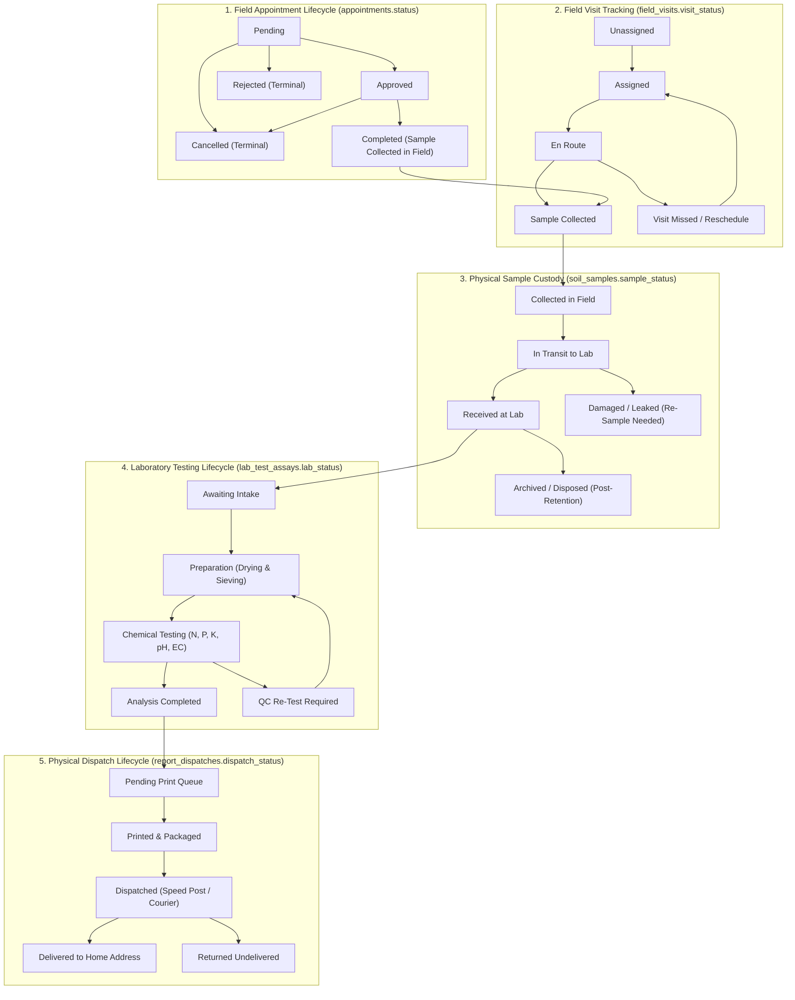
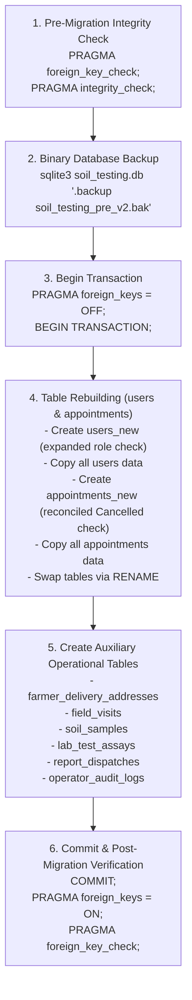

# Operational Workflow & Service Architecture Specification
## Soil Testing Appointment & Report Access Portal
### Milestone: Farmer Service Operations

> **Document Version:** 2.0.0 (Architecture Revision)  
> **Status:** Reviewed & Revised Architecture Design Proposal  
> **Scope:** Multi-role operations, assisted registration, dual-address integrity, appointment lifecycle reconciliation, laboratory & dispatch segregation, migration strategy, and security boundaries.

---

## 1. Executive Summary & Existing Baseline Reconciliation

The authoritative baseline of the **Soil Testing Appointment & Report Access Portal** (`soil-testing-portal/`) consists of:
- **Relational Storage:** SQLite 3 in Write-Ahead Logging (`WAL`) mode with foreign key enforcement (`PRAGMA foreign_keys = ON;`) and a 5000ms busy timeout in [`app/db.py`](file:///Users/manojv/Community%20Project/soil-testing-portal/app/db.py).
- **Core Schema ([`app/schema.sql`](file:///Users/manojv/Community%20Project/soil-testing-portal/app/schema.sql)):**
  - `users`: Enforces `CHECK (role IN ('farmer', 'admin'))`. Normalized E.164 phone as primary login credential with Werkzeug `scrypt` password hashing.
  - `appointments`: Tracks soil sample collection bookings. Foreign key to `users(id)` (`farmer_id`). Enforces `CHECK (preferred_time IN ('09:00-12:00', '14:00-17:00'))` and `CHECK (status IN ('Pending', 'Approved', 'Rejected', 'Completed'))`.
  - `reports`: Tracks uploaded PDF metadata. `appointment_id` is `UNIQUE` (1 report per appointment). UUID-based private disk storage in `instance/reports/`.
- **Security & Authorization:** Cryptographically signed Flask session cookies (`HttpOnly`, `SameSite='Lax'`, conditional `Secure`). Live SQLite role verification on every request via `get_current_user()` in [`app/auth.py`](file:///Users/manojv/Community%20Project/soil-testing-portal/app/auth.py). Double-submit in-memory CSRF validation. Anti-IDOR tenant isolation.
- **Automated Verification:** 159 automated tests passing with 100% success rate across unit, integration, failure-injection, and client levels.

### Purpose of this Revision
This revised specification incorporates critical operational and security requirements:
1. **Assisted Farmer Onboarding without Insecure Passwords:** Operators can register farmers without exposing or inventing website passwords.
2. **Reconciled Appointment Lifecycle:** Reconciles state transitions with existing database constraints and clearly decouples field collection completion from laboratory report completion.
3. **Delivery Address Integrity & Snapshot Preservation:** Implements an immutable address snapshot on dispatch to guarantee postal audit integrity.
4. **Clarified Role Boundaries & Staff Provisioning:** Resolves permission matrix boundaries, segregates call-centre from postal dispatch, and enforces admin-only staff provisioning.
5. **Operational Accuracy:** Real-world caveats marking sampling depth, drying durations, and retention windows as subject to actual laboratory institutional approval, and marking GPS as optional telemetry.
6. **Transactional Maintenance SQLite Migration & Regression Strategy:** Realistic maintenance-window table migration, atomic physical backup, rollback, and test coverage plans replacing inaccurate zero-downtime assumptions.
7. **Formal Deferral of Voice and Telephony Features:** Automated IVR, telephony gateway bridges, Voice PIN authentication, CTI screen-pops, and conversational AI are formally deferred to `Future Phase — Voice Services`. In the active roadmap, call-centre operators assist farmers through standard telephone calls using the secure operator web portal interface. The active implementation sequence is strictly prioritized as:
   - **Phase 8:** Staff Foundation and Assisted Registration
   - **Phase 9:** Field Operations and Sample Tracking
   - **Phase 10:** Laboratory Operations and Report Authorization
   - **Phase 11:** Physical Printing and Postal Delivery

---

## 2. Assisted Farmer Registration Architecture

### 2.1 The Operational Challenge
In rural agricultural communities, many smallholder farmers interact with service centres via telephone calls or village helpdesks. Requiring a farmer to dictate a password over a voice call introduces serious vulnerabilities:
- The operator hears the plaintext password.
- Call recording systems record the password.
- Generating a "default" password (e.g., `Welcome123`) or sending a random password via unencrypted SMS creates immediate credential stuffing and account takeover risks.

### 2.2 The Passwordless Assisted Registration Pattern
The system introduces an **Assisted Registration & Account Claim Pattern** that satisfies `password_hash TEXT NOT NULL` while completely disabling unauthorized web password access until the farmer independently activates their account:

```mermaid
sequenceDiagram
    autonumber
    actor Farmer as Farmer (Phone Call)
    actor Operator as Call-Centre Operator
    participant Portal as Portal Backend (/api/operator/farmers)
    participant DB as SQLite Database

    Farmer->>Operator: Calls helpline; provides Name, Phone (+91...), and Plot details
    Operator->>Portal: POST /api/operator/farmers (name, phone, initial_land_details)
    
    Portal->>DB: Check if phone already exists in users table
    alt Phone Already Registered
        DB-->>Portal: Duplicate phone detected
        Portal-->>Operator: 409 Conflict ("Account already exists for this phone number")
        Operator->>Farmer: Informs farmer; transitions to assisted booking / verification flow
    else Phone Is New
        Portal->>Portal: Generate unguessable, cryptographically disabled password hash
        Note over Portal: Scrypt hash of a 256-bit secure random token (preimage discarded).<br/>Mark registration_source = 'operator_assisted'.
        Portal->>DB: INSERT INTO users (name, phone, password_hash, role) VALUES (?, ?, ?, 'farmer')
        Portal->>DB: INSERT INTO operator_audit_logs (operator_id, farmer_id, action, timestamp)
        DB-->>Portal: Farmer account created (farmer_id)
        Portal-->>Operator: 201 Created (Farmer Profile Created)
        Operator->>Farmer: Confirms registration and proceeds to schedule sample collection
    end

    Note over Farmer,Portal: Optional Future Web Activation (Self-Service)
    alt Farmer Later Wants Web Portal Access
        Farmer->>Portal: Navigates to /register or /login -> "Activate Web Account"
        Portal->>Farmer: Sends 6-digit cryptographic SMS OTP to registered phone
        Farmer->>Portal: Enters SMS OTP + Chooses their own private password (min 8 chars)
        Portal->>DB: Overwrites password_hash with farmer's new personal password hash
        Portal-->>Farmer: Web account activated; farmer logs in securely
    end
```

### 2.3 Security Guarantees
1. **Zero Password Disclosure:** The operator never prompts for, enters, or views any website password.
2. **Web Login Blocked by Default:** The generated password hash corresponds to an unguessable 256-bit random string whose preimage is immediately discarded. Web authentication via `/api/auth/login` fails mathematically because no user or operator knows the password.
3. **No Duplicate Accounts:** Phone number uniqueness is strictly enforced by the SQLite `UNIQUE(phone)` constraint and pre-validation logic.
4. **Independent Account Claiming:** If the farmer subsequently acquires internet access or smartphone capability, they can activate web access through a standard carrier-verified SMS OTP challenge.
5. **Audit Logging:** Every assisted registration records the operator's authenticated user ID, timestamp, and client IP in an immutable `operator_audit_logs` table.

---

## 3. Reconciled Multi-Lifecycle State Machines

A central requirement of the operational design is keeping the **Appointment Status** separate from **Sample Custody Status**, **Laboratory Testing Status**, and **Physical Postal Delivery Status**.

### 3.1 Reconciling Appointment Status with SQLite Constraints
The existing SQLite database enforces:
```sql
CHECK (status IN ('Pending', 'Approved', 'Rejected', 'Completed'))
```
To support cancellation without invalidating existing database rows or breaking existing code:
- **Permitted Appointment States:**
  - `Pending`: Initial state when booking is submitted (by farmer or operator).
  - `Approved`: Visit confirmed by coordinator/admin; field worker assigned.
  - `Rejected`: Coordinator rejects booking (mandatory rejection reason recorded).
  - `Completed`: On-site soil collection visit successfully concluded; sample handed off.
  - `Cancelled` *(Introduced during Phase 8 migration)*: Cancelled before on-site collection.

#### Explicit Permitted State Transitions & Role Authorization
```text
===================================================================================================================
CURRENT STATE    NEXT STATE     ALLOWED ROLES           TRIGGER & BUSINESS RULES
===================================================================================================================
Pending          Approved       admin                   Logistics confirmed; visit window locked.
Pending          Rejected       admin                   Mandatory rejection reason; terminal state.
Pending          Cancelled      farmer, operator, admin Farmer requests cancellation prior to worker assignment.
Approved         Completed      admin, field_worker     On-site visit executed; soil core extracted & tagged.
Approved         Cancelled      farmer, operator, admin Farmer requests cancellation before worker goes En Route.
Rejected         (None)         -                       Terminal state.
Cancelled        (None)         -                       Terminal state.
Completed        (None)         -                       Terminal appointment state (triggers lab lifecycle).
===================================================================================================================
```

### 3.2 Appointment Completion vs. Laboratory Report Completion
It is vital to distinguish between:
1. **Appointment Completion (`appointments.status = 'Completed'`):**
   - Represents the completion of the *field visit*.
   - The field worker visited the agricultural plot, extracted the soil core, tagged the sample, and established physical custody.
   - The farmer's scheduled appointment obligations are fulfilled at this point.
2. **Laboratory Report Completion (`reports` table + `lab_test_assays.lab_status = 'Analysis Completed'`):**
   - Laboratory chemical analysis takes multiple days (drying, sieving, chemical extraction, instrumentation, verification).
   - An appointment reaching `Completed` triggers the *start* of laboratory intake; it does **not** mean the PDF report is immediately available.
   - The digital PDF report is only published once chemical assays are reviewed and scientifically authorized.



---

## 4. Dual-Address Architecture & Immutable Delivery Snapshot

### 4.1 Separation of Concerns
1. **Agricultural Land Location (`land_details` & `appointments`):**
   - Identifies the physical farm plot: survey number, sub-division/gat number, village, taluk, district, and textual landmarks (e.g. "500m behind primary school, near borewell").
   - Consumer: Field Worker and Regional Agricultural Supervisor.
   - Purpose: Directing the worker to the field plot. Never printed on external postal packages.
2. **Home Delivery Address (`farmer_delivery_addresses`):**
   - Identifies the farmer's physical residence: recipient name, door/house number, street/ward, village/town, post office, taluk, district, state, 6-digit postal PIN code, and contact phone.
   - Consumer: Postal Dispatcher, India Post, Commercial Courier.
   - Purpose: Delivering the physical hardcopy Soil Health Certificate. Never accessible to field workers.

### 4.2 Immutable Snapshot Preservation on Dispatch
In standard postal logistics, a farmer may update their profile or change their primary residence. If historical postal dispatch records link dynamically to a mutable address table via foreign key alone, past dispatch records would retroactively change their address. This would destroy audit trails for postal insurance claims, Speed Post tracking disputes, and official records.

**Architectural Rule:** When a report dispatch record is created in `report_dispatches`, the system must freeze and store an **immutable delivery address snapshot** directly in the dispatch record:

```sql
CREATE TABLE IF NOT EXISTS report_dispatches (
    id                   INTEGER PRIMARY KEY AUTOINCREMENT,
    report_id            INTEGER NOT NULL UNIQUE,
    delivery_address_id  INTEGER NOT NULL,
    
    -- Immutable Postal Delivery Address Snapshot (Frozen at dispatch creation)
    snapshot_recipient_name  TEXT NOT NULL,
    snapshot_recipient_phone TEXT NOT NULL,
    snapshot_house_details   TEXT NOT NULL,
    snapshot_street_area     TEXT,
    snapshot_village_town    TEXT NOT NULL,
    snapshot_post_office     TEXT NOT NULL,
    snapshot_taluk           TEXT NOT NULL,
    snapshot_district        TEXT NOT NULL,
    snapshot_state           TEXT NOT NULL,
    snapshot_pincode         TEXT NOT NULL,
    
    -- Dispatch Logistics
    courier_service      TEXT NOT NULL DEFAULT 'India Post Speed Post',
    tracking_number      TEXT UNIQUE, -- e.g. 'EK123456789IN'
    dispatch_status      TEXT NOT NULL DEFAULT 'Pending Print'
                         CHECK (dispatch_status IN ('Pending Print', 'Printed', 'Dispatched', 'Delivered', 'Returned')),
    printed_at           TEXT,
    dispatched_at        TEXT,
    delivered_at         TEXT,
    delivery_notes       TEXT,
    dispatched_by_user   INTEGER NOT NULL,
    created_at           TEXT NOT NULL DEFAULT (CURRENT_TIMESTAMP),
    FOREIGN KEY (report_id) REFERENCES reports (id) ON DELETE RESTRICT,
    FOREIGN KEY (delivery_address_id) REFERENCES farmer_delivery_addresses (id) ON DELETE RESTRICT,
    FOREIGN KEY (dispatched_by_user) REFERENCES users (id) ON DELETE RESTRICT
);
```

**Guarantee:** If a farmer edits or deletes an address in `farmer_delivery_addresses`, all historical `report_dispatches` records retain their exact historical recipient name, door number, post office, and PIN code unaltered.

---

## 5. Granular Role-Based Access Control (RBAC) Matrix

To guarantee strict separation of duties, the system expands to five discrete roles. **Staff accounts (`operator`, `field_worker`, `lab_staff`, `admin`) can ONLY be provisioned by authorized administrators.**

```text
===================================================================================================================
CAPABILITY / RESOURCE               FARMER      OPERATOR      FIELD WORKER     LAB STAFF       ADMINISTRATOR
===================================================================================================================
Self Registration & Profile Edit    YES         NO            NO               NO              NO
Assisted Farmer Onboarding          NO          YES           NO               NO              YES
Create Appointment Request          YES (Own)   YES (Assisted)NO               NO              YES
Cancel Appointment                  YES (Own)*  YES (Assisted)NO               NO              YES
View Appointment Details            YES (Own)   YES (Assisted)YES (Assigned)   YES (Sample No) YES (All)
View Land Location (Field)          YES (Own)   YES           YES (Assigned)   NO              YES
View Home Delivery Address          YES (Own)   YES           NO               NO              YES
Approve / Reject Appointment        NO          NO            NO               NO              YES
Assign Field Worker                 NO          NO            NO               NO              YES
Update Visit Tracking (En Route)    NO          NO            YES (Assigned)   NO              YES
Record Sample Barcode               NO          NO            YES (Assigned)   NO              YES
Acknowledge Sample Intake (Lab)     NO          NO            NO               YES             YES
Enter Chemical Lab Test Results     NO          NO            NO               YES             YES
Sign Off / Authorize Report         NO          NO            NO               NO              YES
Upload Final PDF Report             NO          NO            NO               NO              YES
Download PDF Report                 YES (Own)   NO**          NO               NO              YES
Print Hardcopy Soil Cards           NO          NO            NO               NO              YES***
Dispatch Postal Packages            NO          NO            NO               NO              YES***
Update Consignment Tracking         NO          NO            NO               NO              YES***
Provision Staff Accounts            NO          NO            NO               NO              YES
View System Audit Logs              NO          NO            NO               NO              YES
===================================================================================================================
* Farmers and operators can cancel appointments only while in 'Pending' or 'Approved' status before worker is En Route.
** Operators can explain certified summary parameters to verified callers over the phone, but cannot download raw binary PDFs.
*** Physical printing, postal packaging, and Speed Post tracking updates are on-site operations handled by administrators or designated dispatch staff, NOT telephone operators.
```

### Role Scope & Boundary Definitions
1. **`farmer`:** Smallholder farmer or land cultivator. Strictly tenant-isolated. Can only read and mutate records matching their own `session["user_id"]`.
2. **`operator` (Call-Centre / Helpdesk):** Front-desk agent. Onboards farmers and books appointments on their behalf. Inquires about status on behalf of verified telephone callers. **Strictly prohibited from printing or packaging mail, downloading binary PDFs, or altering laboratory assay results.**
3. **`field_worker` (Soil Collector):** Field sampler. Access is strictly scoped to assigned visits within their sector (`assigned_worker_id == session["user_id"]`). Views plot survey numbers and field landmarks. **Strictly prohibited from viewing home delivery addresses, financial records, or other workers' assignments.**
4. **`lab_staff` (Laboratory Chemist / Technician):** Operates under a **blind testing protocol**. Access is keyed strictly by anonymous `sample_code`. Records chemical values (pH, N, P, K). **Strictly prohibited from viewing farmer personal names, contact phone numbers, or dispatch tracking.**
5. **`admin` (Lab Director / Coordinator):** Central governance. Provisions staff accounts, approves/rejects appointments, assigns workers, verifies test assays, signs off on reports, and manages postal dispatch queues.

---

## 6. Operational Accuracy & Real-World Caveats

To ensure professional integrity, the system design avoids hardcoding arbitrary agronomic rules or assuming technical infrastructure that may not exist in rural field environments.

### 6.1 Institutional Operational Policies
The following operational parameters are defined as **subject to formal review, calibration, and approval by the participating testing laboratory or agronomic institution**:
- **Sampling Depth:** Standard default is nominally 15 cm for field crops, but actual depth constraints (e.g. 0–15 cm for shallow rooted crops, 15–30 cm for deep-rooted horticulture) are configurable institutional parameters.
- **Sample Preparation & Drying:** Air drying temperature thresholds (nominally $< 35^\circ\text{C}$), drying duration (24–48 hours depending on ambient humidity), and sieve mesh gauge (nominally 2mm) must follow the participating laboratory's standard operating procedures (SOP).
- **Sample Retention Windows:** Physical sample retention duration post-testing (e.g. 30 to 60 days before safe bio-disposal) is governed by institutional quality control and re-testing guidelines.

### 6.2 Optional GPS Telemetry
Field worker mobile devices in rural areas frequently experience poor satellite lock, device hardware limitations, or battery constraints.
- **Architectural Policy:** GPS coordinates (`gps_latitude`, `gps_longitude`) in `field_visits` are strictly **optional telemetry**.
- **Graceful Fallback:** If GPS is unavailable, the visit record relies on statutory administrative identifiers: Survey Number, Plot Sub-division Number, Village, and Textual Landmarks. A field visit cannot be blocked merely because GPS telemetry fails.

### 6.3 Standardized Sample Identifiers
Physical samples are tagged with a human-readable, barcode-compatible alphanumeric format:
```text
Format: SMP-[YEAR]-[SEQUENTIAL_HEX_OR_DIGIT]
Example: SMP-2026-0042
```
This identifier is printed on high-durability, moisture-resistant barcode labels affixed to the sample bag immediately upon field extraction.

---

## 7. Transactional Maintenance SQLite Migration & Regression Strategy

### 7.1 Realistic SQLite Migration Plan (`migrate_v1_to_v2.py`)
Because SQLite relies on file-level locks and does not support disabling foreign keys inside active transactions, attempting schema table swaps under live concurrency risks lock contention or transient constraint violations. The migration requires a brief scheduled maintenance window during which exclusive locks are acquired:



### 7.2 Backup & Rollback Protocol
1. **Pre-Migration Backup:**
   Before executing any DDL statements, create an atomic physical snapshot:
   ```bash
   sqlite3 instance/soil_testing.db ".backup 'instance/soil_testing_pre_v2.bak'"
   ```
2. **Rollback Procedure:**
   If any migration statement fails:
   - The transaction immediately rolls back (`ROLLBACK;`).
   - If the file was partially written, restore from backup:
     ```bash
     cp instance/soil_testing_pre_v2.bak instance/soil_testing.db
     ```
   - All existing 159 tests will continue running against the restored v1 schema without regression.

### 7.3 Automated Test Suite Expansion (Regression Prevention)
The migration must be validated against a dedicated test suite (`tests/test_operations_migration.py`):
1. **Data Preservation Verification:**
   - Assert that existing farmer accounts (`users`), appointments (`appointments`), and PDF reports (`reports`) retain identical IDs, hashes, and foreign key linkages post-migration.
2. **Constraint & Role Verification:**
   - Verify that new roles (`operator`, `field_worker`, `lab_staff`) can be inserted into `users`, while invalid roles (e.g. `'superadmin'`, `'guest'`) trigger SQLite `CHECK` constraint violations.
   - Verify that `appointments` accepts `Cancelled` status transitions according to the state machine.
3. **Foreign Key Cascade & Delete Restrict Tests:**
   - Verify that deleting a user referenced by `field_visits` or `report_dispatches` triggers an `IntegrityError` (`ON DELETE RESTRICT`).
4. **Existing Suite Regression:**
   - Execute all 159 existing test cases in `tests/` to guarantee zero breaking changes to existing farmer or admin workflows.
### 7.2 Backup & Rollback Protocol
1. **Pre-Migration Backup:**
   Before executing any DDL statements, create an atomic physical snapshot:
   ```bash
   sqlite3 instance/soil_testing.db ".backup 'instance/soil_testing_pre_v2.bak'"
   ```
2. **Rollback Procedure:**
   If any migration statement fails:
   - The transaction immediately rolls back (`ROLLBACK;`).
   - If the file was partially written, restore from backup:
     ```bash
     cp instance/soil_testing_pre_v2.bak instance/soil_testing.db
     ```
   - All existing 159 tests will continue running against the restored v1 schema without regression.

### 7.3 Automated Test Suite Expansion (Regression Prevention)
The migration must be validated against a dedicated test suite (`tests/test_operations_migration.py`):
1. **Data Preservation Verification:**
   - Assert that existing farmer accounts (`users`), appointments (`appointments`), and PDF reports (`reports`) retain identical IDs, hashes, and foreign key linkages post-migration.
2. **Constraint & Role Verification:**
   - Verify that new roles (`operator`, `field_worker`, `lab_staff`) can be inserted into `users`, while invalid roles (e.g. `'superadmin'`, `'guest'`) trigger SQLite `CHECK` constraint violations.
   - Verify that `appointments` accepts `Cancelled` status transitions according to the state machine.
3. **Foreign Key Cascade & Delete Restrict Tests:**
   - Verify that deleting a user referenced by `field_visits` or `report_dispatches` triggers an `IntegrityError` (`ON DELETE RESTRICT`).
4. **Existing Suite Regression:**
   - Execute all 159 existing test cases in `tests/` to guarantee zero breaking changes to existing farmer or admin workflows.
