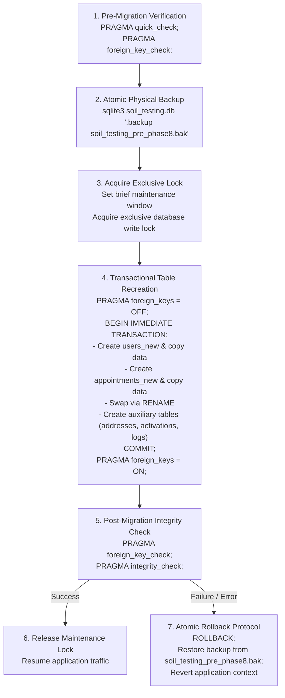
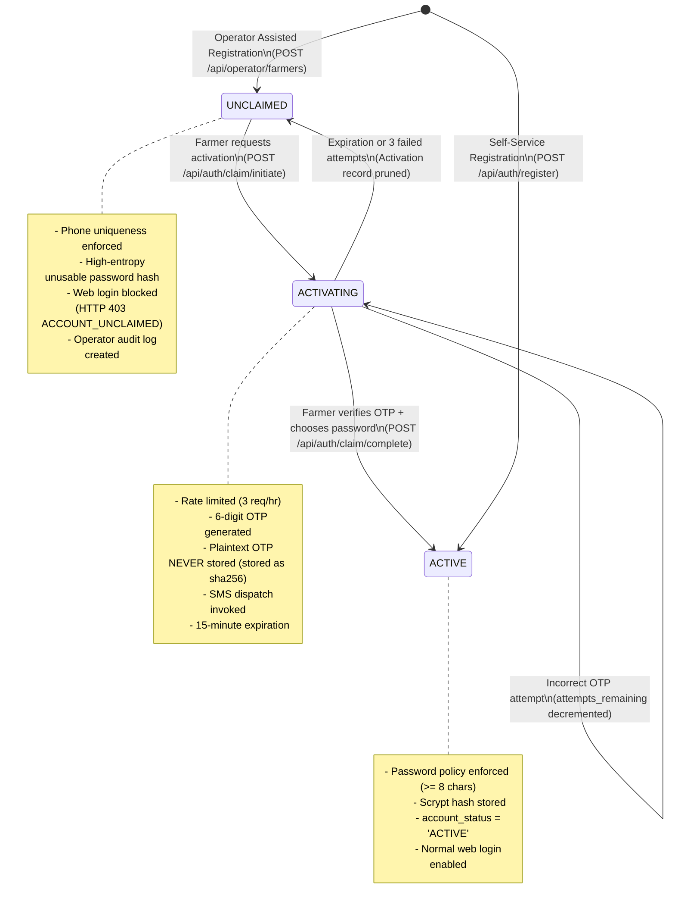

# Phase 8 Implementation Specification
## Staff Foundation and Assisted Registration
### Soil Testing Appointment & Report Access Portal

> **Document Version:** 1.0.0  
> **Status:** Architecture Audit & Implementation Specification (Pre-Implementation Phase)  
> **Target Phase:** Phase 8 — Staff Foundation and Assisted Registration  
> **Baseline Test Count:** 159 passing automated tests (100% pass rate)

---

## 1. Executive Summary & Audit Baseline

An architecture audit of the **Soil Testing Appointment & Report Access Portal** (`soil-testing-portal/`) was conducted to prepare **Phase 8** for implementation. 

### 1.1 Existing Implementation vs. Documentation Audit Findings
- **Database Schema ([`app/schema.sql`](file:///Users/manojv/Community%20Project/soil-testing-portal/app/schema.sql)):**
  - Existing `users` table enforces `CHECK (role IN ('farmer', 'admin'))`. Normalized E.164 phone is unique. Plaintext passwords are not stored; Werkzeug `scrypt` hashing is enforced.
  - Existing `appointments` table has single `address` text column and enforces `CHECK (status IN ('Pending', 'Approved', 'Rejected', 'Completed'))`.
  - There is currently **no database migration framework** (no Alembic / Flask-Migrate). Tables are created on startup via `init_db()` using `app/schema.sql`.
- **Authentication & Authorization ([`app/auth.py`](file:///Users/manojv/Community%20Project/soil-testing-portal/app/auth.py)):**
  - Public registration (`POST /api/auth/register`) hardcodes `role='farmer'` and requires password $\ge 8$ chars.
  - `@login_required`, `@admin_required`, `@farmer_required` reload the user record from SQLite on every request via `get_current_user()`, preventing stale session elevation.
- **CSRF & Sessions ([`app/__init__.py`](file:///Users/manojv/Community%20Project/soil-testing-portal/app/__init__.py)):**
  - Signed session cookies (`HttpOnly=True`, `SameSite='Lax'`, conditional `Secure=True`). Double-submit CSRF token checked on mutating verbs (`POST`, `PUT`, `PATCH`, `DELETE`).
- **Test Baseline:** Full regression suite reports **159 passed tests in ~23s** with 0 failures and 0 warnings.

---

## 2. Architecture Decisions & Resolution of Key Questions

### 2.1 Realistic SQLite Database Migration Strategy

#### Why "Zero-Downtime" is Replaced
SQLite is an embedded, serverless, file-backed relational database engine. In SQLite:
1. Modifying existing column `CHECK` constraints (e.g. `users.role` or `appointments.status`) requires **table recreation** (creating a new table, copying rows, dropping the old table, and renaming).
2. `PRAGMA foreign_keys = OFF` cannot be safely toggled inside an active multi-statement transaction.
3. SQLite relies on file-level locks (`WAL` mode allows concurrent readers, but only **one writer** at any instant). Attempting schema swaps under high concurrent traffic risks lock timeouts or broken foreign keys.

Therefore, the inaccurate "zero-downtime" claim is replaced with a **realistic transactional maintenance migration strategy**:



#### Detailed Migration Steps
1. **Pre-Migration Safety & Integrity Check:**
   Verify the active database has zero corrupt pages or orphan foreign keys:
   ```sql
   PRAGMA integrity_check;
   PRAGMA foreign_key_check;
   ```
2. **Physical Backup Procedure:**
   Before running any migration DDL, generate an atomic binary backup using the SQLite backup API:
   ```bash
   sqlite3 instance/soil_testing.db ".backup 'instance/soil_testing_pre_phase8.bak'"
   ```
   *Guarantees a byte-for-byte consistent point-in-time snapshot, even if WAL frames are pending.*
3. **Transaction Boundaries & Table Recreation:**
   The migration runs as a dedicated Python management script (`app/migrations/migrate_phase8.py`):
   ```python
   def run_phase8_migration(db_path):
       conn = sqlite3.connect(db_path, timeout=10.0)
       conn.execute("PRAGMA foreign_keys = OFF;")
       cur = conn.cursor()
       try:
           cur.execute("BEGIN IMMEDIATE TRANSACTION;")
           
           # 1. Rebuild users table with expanded roles & account_status
           cur.execute("""
               CREATE TABLE users_new (
                   id                 INTEGER PRIMARY KEY AUTOINCREMENT,
                   name               TEXT NOT NULL,
                   phone              TEXT NOT NULL UNIQUE,
                   password_hash      TEXT NOT NULL,
                   role               TEXT NOT NULL DEFAULT 'farmer' 
                                      CHECK (role IN ('farmer', 'operator', 'field_worker', 'lab_staff', 'admin')),
                   account_status     TEXT NOT NULL DEFAULT 'ACTIVE'
                                      CHECK (account_status IN ('UNCLAIMED', 'ACTIVE', 'SUSPENDED')),
                   created_by_user_id INTEGER,
                   created_at         TEXT NOT NULL DEFAULT (CURRENT_TIMESTAMP),
                   FOREIGN KEY (created_by_user_id) REFERENCES users_new(id) ON DELETE SET NULL
               );
           """)
           cur.execute("""
               INSERT INTO users_new (id, name, phone, password_hash, role, account_status, created_at)
               SELECT id, name, phone, password_hash, role, 'ACTIVE', created_at FROM users;
           """)
           cur.execute("DROP TABLE users;")
           cur.execute("ALTER TABLE users_new RENAME TO users;")

           # 2. Rebuild appointments table with reconciled 'Cancelled' status
           cur.execute("""
               CREATE TABLE appointments_new (
                   id             INTEGER PRIMARY KEY AUTOINCREMENT,
                   farmer_id      INTEGER NOT NULL,
                   land_details   TEXT NOT NULL,
                   address        TEXT NOT NULL,
                   preferred_date TEXT NOT NULL,
                   preferred_time TEXT NOT NULL CHECK (preferred_time IN ('09:00-12:00', '14:00-17:00')),
                   notes          TEXT,
                   status         TEXT NOT NULL DEFAULT 'Pending' 
                                  CHECK (status IN ('Pending', 'Approved', 'Rejected', 'Completed', 'Cancelled')),
                   created_at     TEXT NOT NULL DEFAULT (CURRENT_TIMESTAMP),
                   updated_at     TEXT NOT NULL DEFAULT (CURRENT_TIMESTAMP),
                   FOREIGN KEY (farmer_id) REFERENCES users (id) ON DELETE RESTRICT
               );
           """)
           cur.execute("""
               INSERT INTO appointments_new (id, farmer_id, land_details, address, preferred_date, preferred_time, notes, status, created_at, updated_at)
               SELECT id, farmer_id, land_details, address, preferred_date, preferred_time, notes, status, created_at, updated_at FROM appointments;
           """)
           cur.execute("DROP TABLE appointments;")
           cur.execute("ALTER TABLE appointments_new RENAME TO appointments;")
           cur.execute("CREATE INDEX idx_appointments_farmer_id ON appointments (farmer_id);")
           cur.execute("CREATE INDEX idx_appointments_status ON appointments (status);")

           # 3. Create Auxiliary Tables
           cur.execute("""
               CREATE TABLE IF NOT EXISTS farmer_delivery_addresses (
                   id               INTEGER PRIMARY KEY AUTOINCREMENT,
                   farmer_id        INTEGER NOT NULL,
                   recipient_name   TEXT NOT NULL,
                   recipient_phone  TEXT NOT NULL,
                   house_details    TEXT NOT NULL,
                   street_area      TEXT,
                   village_town     TEXT NOT NULL,
                   post_office      TEXT NOT NULL,
                   taluk            TEXT NOT NULL,
                   district         TEXT NOT NULL,
                   state            TEXT NOT NULL DEFAULT 'Karnataka',
                   pincode          TEXT NOT NULL CHECK (length(pincode) = 6 AND pincode GLOB '[1-9][0-9][0-9][0-9][0-9][0-9]'),
                   is_default       INTEGER NOT NULL DEFAULT 1 CHECK (is_default IN (0, 1)),
                   created_at       TEXT NOT NULL DEFAULT (CURRENT_TIMESTAMP),
                   updated_at       TEXT NOT NULL DEFAULT (CURRENT_TIMESTAMP),
                   FOREIGN KEY (farmer_id) REFERENCES users (id) ON DELETE RESTRICT
               );
           """)
           cur.execute("CREATE INDEX IF NOT EXISTS idx_delivery_addresses_farmer ON farmer_delivery_addresses (farmer_id);")

           cur.execute("""
               CREATE TABLE IF NOT EXISTS farmer_account_activations (
                   id                 INTEGER PRIMARY KEY AUTOINCREMENT,
                   farmer_id          INTEGER NOT NULL UNIQUE,
                   claim_token_hash   TEXT NOT NULL UNIQUE,
                   otp_hash           TEXT NOT NULL,
                   attempts_remaining INTEGER NOT NULL DEFAULT 3 CHECK (attempts_remaining >= 0),
                   expires_at         TEXT NOT NULL,
                   created_at         TEXT NOT NULL DEFAULT (CURRENT_TIMESTAMP),
                   FOREIGN KEY (farmer_id) REFERENCES users (id) ON DELETE CASCADE
               );
           """)

           cur.execute("""
               CREATE TABLE IF NOT EXISTS operator_audit_logs (
                   id                 INTEGER PRIMARY KEY AUTOINCREMENT,
                   actor_user_id      INTEGER NOT NULL,
                   actor_role         TEXT NOT NULL,
                   action             TEXT NOT NULL,
                   target_entity_type TEXT NOT NULL,
                   target_entity_id   INTEGER NOT NULL,
                   details_json       TEXT,
                   created_at         TEXT NOT NULL DEFAULT (CURRENT_TIMESTAMP),
                   FOREIGN KEY (actor_user_id) REFERENCES users (id) ON DELETE RESTRICT
               );
           """)

           conn.commit()
       except Exception as e:
           conn.rollback()
           raise e
       finally:
           conn.execute("PRAGMA foreign_keys = ON;")
           fk_violations = conn.execute("PRAGMA foreign_key_check;").fetchall()
           if fk_violations:
               raise RuntimeError(f"Post-migration foreign key integrity violation: {fk_violations}")
           conn.close()
   ```
4. **Failure & Rollback Behavior:**
   - If an unhandled exception or constraint error occurs midway before `COMMIT`, SQLite rolls back the transaction.
   - If unexpected disk failure damages the active file, the pre-migration backup `soil_testing_pre_phase8.bak` is copied back to restore `soil_testing.db`.
   - Existing 159 tests will immediately pass against the restored baseline.

---

### 2.2 Assisted Farmer Registration Lifecycle: `UNCLAIMED → ACTIVE`



#### Detailed Lifecycle Stages
1. **Operator Creation Stage:**
   - **Endpoint:** `POST /api/operator/farmers` (requires `@operator_required` or `@admin_required`).
   - **Input:** `name`, `phone` (E.164 format, e.g. `+919876543210`).
   - **Duplicate Defense:** Validates `phone` against `users.phone`. Returns `409 Conflict` if already registered.
   - **Password Security:** Server generates an unguessable 256-bit random token using `secrets.token_bytes(32)`. The token is immediately hashed via Werkzeug `generate_password_hash(secret, method='scrypt')`. Preimage is never displayed, logged, or communicated.
   - **Initial Status:** Sets `role='farmer'` and `account_status='UNCLAIMED'`.
   - **Audit Record:** Appends to `operator_audit_logs`:
     `actor_user_id = operator.id`, `action = 'ASSISTED_REGISTRATION'`, `target_entity_id = farmer.id`.
2. **Web Login Block on Unclaimed Accounts:**
   - In `POST /api/auth/login`:
     ```python
     if user["account_status"] == "UNCLAIMED":
         return error_response(
             code="ACCOUNT_UNCLAIMED",
             message="This account was created via telephone assistance and has not been activated for web login. Please use 'Activate Account' to set your password.",
             status_code=403
         )
     ```
   - Prevents credential stuffing or web login attempts until the farmer explicitly claims the profile.
3. **Account Claim Initiation Stage:**
   - **Endpoint:** `POST /api/auth/claim/initiate` (Public).
   - **Input:** `phone` (E.164 format).
   - **Validation:** Finds user with `phone` and `account_status == 'UNCLAIMED'`.
   - **Rate Limiting:** Maximum 3 initiation requests per phone per hour.
   - **Secret Handling:**
     - Generates 6-digit numeric OTP: `otp = f"{secrets.randbelow(900000) + 100000}"`.
     - Generates 32-byte claim token: `claim_token = secrets.token_hex(32)`.
     - **No Plaintext Storage:** Computes `claim_token_hash = sha256(claim_token)` and `otp_hash = sha256(otp)`.
     - Inserts/replaces record in `farmer_account_activations` with `expires_at = CURRENT_TIMESTAMP + 15 minutes` and `attempts_remaining = 3`.
   - **SMS Delivery Dependency:**
     - Invokes pluggable `SMSProvider.send_otp(phone, otp)`.
     - *Identified Dependency:* Production requires integration with an approved Indian SMS carrier / DLT portal (e.g. CDAC / Twilio / Kaleyra). In local development and automated testing, a `MockSMSProvider` logs or stores the OTP in memory for test assertions.
   - Returns HTTP 200 with `{ "status": "success", "claim_token": claim_token, "expires_in_seconds": 900 }`.
4. **Account Claim Completion Stage:**
   - **Endpoint:** `POST /api/auth/claim/complete` (Public).
   - **Input:** `claim_token`, `otp`, `new_password`.
   - **Validation:**
     - Finds record matching `sha256(claim_token)`.
     - Checks `expires_at > CURRENT_TIMESTAMP`. If expired, returns `400 Bad Request` (`"ACTIVATION_EXPIRED"`).
     - Checks `attempts_remaining > 0`. If 0, returns `403 Forbidden` (`"MAX_ATTEMPTS_EXCEEDED"`).
     - Verifies `sha256(otp)` using `secrets.compare_digest`.
     - If incorrect: decrements `attempts_remaining` and returns `401 Unauthorized` with remaining attempts count.
     - If correct:
       - Enforces password policy: $\ge 8$ characters, non-empty.
       - Hashes password: `new_hash = generate_password_hash(new_password)`.
       - Executes atomic update:
         `UPDATE users SET password_hash = ?, account_status = 'ACTIVE', updated_at = CURRENT_TIMESTAMP WHERE id = ?`
       - Deletes row from `farmer_account_activations`.
       - Appends audit log: `action = 'ACCOUNT_ACTIVATED'`.
       - Returns HTTP 200 OK. Farmer can now log in normally via web interface.

---

### 2.3 Reconciled Appointment Lifecycle

```text
===================================================================================================================
STATUS       MEANING / OPERATIONAL CONTEXT                     ALLOWED TRANSITIONS       AUTHORIZED ACTORS
===================================================================================================================
Pending      Booking request submitted by farmer or operator.  -> Approved               admin
             Awaiting coordinator review and scheduling.       -> Rejected               admin (reason required)
                                                               -> Cancelled              farmer, operator, admin

Approved     Visit logistics confirmed; time window locked;    -> Cancelled              farmer, operator, admin
             ready for field worker assignment.                -> Completed              field_worker, admin

Rejected     Coordinator rejected request (e.g. out of service (Terminal State)          -
             boundary, flooded plot). Mandatory reason logged.

Cancelled    Booking cancelled prior to sample collection.     (Terminal State)          -
             Field worker dispatch aborted.

Completed    On-site field visit finished; composite soil core (Terminal Appointment     -
             extracted, bagged, and tagged with barcode.       State; triggers lab assay)
===================================================================================================================
```

#### Decoupling Appointment Completion from Laboratory Completion
1. **Appointment Completion (`appointments.status = 'Completed'`):**
   - Marks the successful conclusion of the *on-site field visit*. The soil core has been extracted, tagged with a sample code, and handed over for laboratory transport. The farmer's scheduled appointment obligations are fulfilled.
2. **Laboratory Operations (`lab_test_assays` in Phase 10):**
   - Laboratory testing takes days (air drying, 2mm sieving, chemical extraction, spectrophotometry).
   - `Completed` appointment status does **not** mean the PDF report is ready.
   - The digital PDF report is only published once chemical assays are reviewed and scientifically authorized.
3. **Preserving Existing API Behavior:**
   - In Phase 8, `app/reports.py` upload route precondition (`appointment['status'] == 'Completed'`) continues to function for all existing tests and workflows. Existing endpoint signatures remain unchanged.

---

### 2.4 Staff Roles and MVP Permission Resolution

#### Resolution on Physical Dispatch Role for MVP
- **Question:** Does physical postal delivery require a separate dedicated role (`dispatch_staff`) in the database for Phase 8?
- **Analysis:**
  - Call-centre operators handle telephone communications, assisted onboarding, and appointment booking; they do **not** work on-site in the testing laboratory where physical printing and postal collection take place.
  - Adding a separate `dispatch_staff` role in Phase 8 introduces schema overhead before physical printing (Phase 11) is even active.
- **Decision:** **For the MVP, physical printing, packaging, and Speed Post tracking updates are assigned strictly to `admin` (or designated on-site staff operating under administrative credentials). Call-centre operators are strictly prohibited from dispatch operations.** A separate dispatch role is deferred until Phase 11 if operational volume requires it.

#### Phase 8 Granular Role Permission Matrix
```text
===================================================================================================================
CAPABILITY / RESOURCE               FARMER      OPERATOR      FIELD WORKER     LAB STAFF       ADMINISTRATOR
===================================================================================================================
Self Registration (Web)             YES         NO            NO               NO              NO
Assisted Farmer Onboarding          NO          YES           NO               NO              YES
Web Account Claim / Activation      YES         NO            NO               NO              NO
Create Appointment Booking          YES (Own)   YES (Assisted)NO               NO              YES
Cancel Appointment                  YES (Own)*  YES (Assisted)NO               NO              YES
View Appointment Details            YES (Own)   YES (Assisted)YES (Assigned)** YES (Assigned)**YES (All)
View Land Location (Field Details)  YES (Own)   YES           YES (Assigned)   NO              YES
View Home Delivery Address          YES (Own)   YES           NO               NO              YES
Approve / Reject Appointment        NO          NO            NO               NO              YES
Assign Field Worker                 NO          NO            NO               NO              YES
Mark Visit 'Completed'              NO          NO            YES (Assigned)   NO              YES
Acknowledge Sample Intake (Lab)     NO          NO            NO               YES             YES
Enter Chemical Test Results         NO          NO            NO               YES             YES
Sign Off / Authorize Report         NO          NO            NO               NO              YES
Upload Final PDF Report             NO          NO            NO               NO              YES
Download PDF Report                 YES (Own)   NO            NO               NO              YES
Dispatch Physical Postal Mail       NO          NO            NO               NO              YES
Provision / Deactivate Staff Roles  NO          NO            NO               NO              YES
View Operator Audit Logs            NO          NO            NO               NO              YES
===================================================================================================================
* Farmers and operators can cancel appointments only while in 'Pending' or 'Approved' status prior to worker dispatch.
** In Phase 8, field workers and lab staff accounts can be provisioned; full assignment views activate in Phases 9 and 10.
```

---

### 2.5 Application-Level Audit Logging Strategy

#### Database Structure: `operator_audit_logs`
```sql
CREATE TABLE IF NOT EXISTS operator_audit_logs (
    id                 INTEGER PRIMARY KEY AUTOINCREMENT,
    actor_user_id      INTEGER NOT NULL,
    actor_role         TEXT NOT NULL,
    action             TEXT NOT NULL,
    target_entity_type TEXT NOT NULL,
    target_entity_id   INTEGER NOT NULL,
    details_json       TEXT,
    ip_address         TEXT,
    user_agent         TEXT,
    created_at         TEXT NOT NULL DEFAULT (CURRENT_TIMESTAMP),
    FOREIGN KEY (actor_user_id) REFERENCES users (id) ON DELETE RESTRICT
);
CREATE INDEX IF NOT EXISTS idx_audit_logs_actor ON operator_audit_logs (actor_user_id);
CREATE INDEX IF NOT EXISTS idx_audit_logs_target ON operator_audit_logs (target_entity_type, target_entity_id);
```

#### Application-Level Immutability Protection
1. **No Application Mutators:** The application exposes **zero** `UPDATE` or `DELETE` route handlers or repository methods for audit logs.
2. **Database Trigger Guard:** SQLite triggers prevent ordinary application-level modification:
   ```sql
   CREATE TRIGGER IF NOT EXISTS trg_audit_logs_no_update
   BEFORE UPDATE ON operator_audit_logs
   BEGIN
       SELECT RAISE(ABORT, 'Audit log records are append-only and cannot be updated.');
   END;

   CREATE TRIGGER IF NOT EXISTS trg_audit_logs_no_delete
   BEFORE DELETE ON operator_audit_logs
   BEGIN
       SELECT RAISE(ABORT, 'Audit log records are append-only and cannot be deleted.');
   END;
   ```
   *(Acknowledging reality: A superuser with direct root access to the physical `.db` file could bypass triggers; but within the application and SQL abstraction layer, records are strictly append-only).*
3. **Events to Record:**
   - `ASSISTED_REGISTRATION`: Operator onboards a new farmer.
   - `ASSISTED_BOOKING`: Operator creates an appointment on behalf of a farmer.
   - `DELIVERY_ADDRESS_CREATED`: Operator or farmer adds a postal delivery address.
   - `ACCOUNT_CLAIM_INITIATED`: Farmer requests activation SMS OTP.
   - `ACCOUNT_ACTIVATED`: Farmer successfully verifies OTP and establishes web password.
   - `STAFF_PROVISIONED`: Administrator creates an `operator`, `field_worker`, or `lab_staff` account.
4. **Data Redaction (What Must NEVER Be Logged):**
   - Plaintext passwords or pre-hash strings.
   - Password hashes.
   - Plaintext OTP codes or activation tokens.
   - Session cookie values or CSRF secret keys.
5. **Access Control:**
   - Only users with `role == 'admin'` can access audit log query endpoints (`GET /api/admin/audit-logs`). Operators and farmers receive `403 Forbidden`.

---

## 3. Measurable Acceptance Criteria for Phase 8

To consider Phase 8 complete, the implementation must satisfy all of the following criteria under automated testing:

### 3.1 Staff Account Provisioning
- [ ] Admin can provision staff accounts (`role IN ('operator', 'field_worker', 'lab_staff')`) via authenticated endpoint `POST /api/admin/staff` and CLI command `flask init-staff`.
- [ ] Non-admin users (farmers, operators, field workers) receive HTTP 403 Forbidden when attempting to provision staff accounts.
- [ ] Attempting to provision a staff account with an invalid role (e.g. `'superadmin'`) returns HTTP 400 Validation Error.
- [ ] Staff passwords enforce minimum 8 characters and are hashed with Scrypt.

### 3.2 Role-Based Authorization
- [ ] `@operator_required` grants access strictly to users with `role IN ('operator', 'admin')`; returns 401 for unauthenticated and 403 for `farmer`, `field_worker`, `lab_staff`.
- [ ] `@field_worker_required` grants access strictly to `field_worker` and `admin`.
- [ ] `@lab_staff_required` grants access strictly to `lab_staff` and `admin`.
- [ ] Stale session test: Updating user role in database immediately reflects on the next request without re-login (reloaded via `get_current_user()`).

### 3.3 Assisted Farmer Registration
- [ ] Operator can register a farmer via `POST /api/operator/farmers` by supplying `name` and valid E.164 `phone`.
- [ ] Server sets `role = 'farmer'`, `account_status = 'UNCLAIMED'`, and a cryptographically disabled password hash.
- [ ] Submitting an already-registered phone returns HTTP 409 Conflict with clear error details.
- [ ] Submitting malformed phone numbers (non-E.164) returns HTTP 400 Validation Error.
- [ ] Unauthenticated callers receive 401; farmers receive 403.
- [ ] Successful registration generates an append-only audit record in `operator_audit_logs`.

### 3.4 Web Account Activation (`UNCLAIMED → ACTIVE`)
- [ ] Attempting `POST /api/auth/login` on an `UNCLAIMED` account fails with HTTP 403 and error code `"ACCOUNT_UNCLAIMED"`.
- [ ] `POST /api/auth/claim/initiate` with valid unclaimed phone generates 6-digit OTP and 32-byte claim token; returns token and expiration. Plaintext OTP is NOT saved to disk or DB.
- [ ] `POST /api/auth/claim/initiate` is rate-limited to 3 requests per phone per hour.
- [ ] `POST /api/auth/claim/complete` with incorrect OTP decrements attempts; on 3rd failure, invalidates token and returns 403.
- [ ] `POST /api/auth/claim/complete` with correct OTP and valid password ($\ge 8$ chars) updates `account_status = 'ACTIVE'`, updates `password_hash`, prunes activation record, and logs audit event.
- [ ] Activated farmer can immediately authenticate via `POST /api/auth/login` using their new password.

### 3.5 Decoupled Delivery Address
- [ ] Farmer or operator can add a home delivery address via `POST /api/farmers/<id>/delivery-addresses`.
- [ ] Validates 6-digit Indian postal PIN code format (`GLOB '[1-9][0-9][0-9][0-9][0-9][0-9]'`). Rejects invalid PIN codes with HTTP 400.
- [ ] Field workers querying visit details receive land plot location, but cannot view home delivery addresses.

### 3.6 Operator Audit Logging
- [ ] All operator-assisted registrations and bookings create immutable audit rows in `operator_audit_logs`.
- [ ] Audit logs store `actor_user_id`, `actor_role`, `action`, `target_entity_type`, `target_entity_id`, and client IP.
- [ ] Audit log rows reject SQL `UPDATE` and `DELETE` statements via database trigger.
- [ ] `GET /api/admin/audit-logs` returns paginated audit records for `admin`, and 403 for non-admins.

### 3.7 Database Migration & Full Regression Safety
- [ ] Migration script runs within a transaction and executes pre/post foreign key checks (`PRAGMA foreign_key_check`).
- [ ] Migration script creates a physical `.bak` file before altering tables.
- [ ] All existing farmer accounts, appointments, and reports retain identical IDs and foreign key links post-migration.
- [ ] **Zero Regression:** All 159 existing test cases in `tests/` pass with 100% success rate post-migration.

---

## 4. External Dependencies & Unresolved Decisions

### 4.1 Identified External Dependencies
1. **SMS Gateway Provider:**
   - Account activation and OTP delivery require a carrier SMS provider (e.g. CDAC / Twilio / Kaleyra / Karix) compliant with TRAI DLT registration in India.
   - *Phase 8 Architecture Pattern:* Implement an abstract `SMSProvider` class with a `MockSMSProvider` for development and automated tests. Production carrier credentials remain an environment-configured dependency.
2. **Postal Tracking Integration:**
   - Consignment tracking with India Post Speed Post requires an institutional tracking API or manual tracking number entry interface (deferred to Phase 11).

### 4.2 Explicit List of Decisions Requiring Stakeholder Approval
- [ ] **Approval 1 (Activation Expiry Window):** Confirm that the 15-minute expiration window and 3-attempt limit for account activation OTPs meet operational usability requirements.
- [ ] **Approval 2 (Dispatch Role in Phase 8):** Confirm that postal dispatch operations remain restricted to `admin` for the Phase 8 MVP, deferring a separate dispatch clerk role to Phase 11.
- [ ] **Approval 3 (Maintenance Window Protocol):** Confirm that Phase 8 SQLite schema migrations will be executed during a brief scheduled maintenance window with pre-migration `.bak` backup, replacing unviable zero-downtime assumptions.
