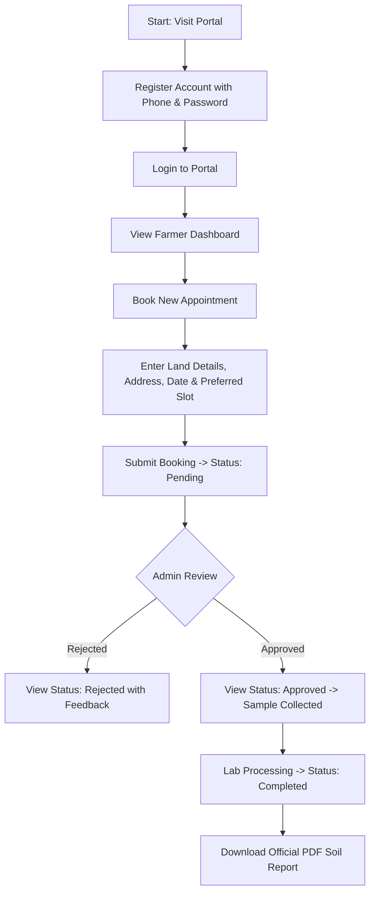
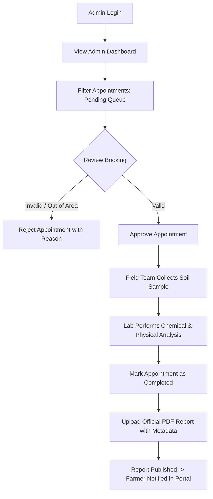

# Project Overview: Soil Testing Appointment & Report Access Portal

---

## 1. Project Introduction

The **Soil Testing Appointment & Report Access Portal** is a community-focused web platform developed as an academic and community initiative. It bridges the gap between agricultural landholders (farmers, rural communities, community gardeners) and institutional soil testing laboratories.

The portal provides an intuitive, accessible interface for farmers to schedule on-site soil sample collections and retrieve digital soil test certificates. Simultaneously, it equips agricultural laboratory staff and administrators with a streamlined portal to schedule visits, manage testing queues, and publish laboratory findings securely.

---

## 2. Problem Statement

Smallholder farmers and rural gardeners face significant friction when accessing soil testing services:
- **Manual, paper-based booking:** Scheduling soil sample collections often requires physical visits to testing centers or untracked telephone calls.
- **Queue opacity:** Farmers have no visibility into the status of their sample collection or lab analysis.
- **Physical report distribution delays:** Printed paper reports are susceptible to physical damage, loss, or extended mailing delays, preventing timely fertilizer and crop planning.
- **Administrative overhead:** Testing centers manage records across disjointed notebooks and spreadsheets, increasing risk of missed appointments and lost test reports.

---

## 3. Project Objectives

1. **Digitize Appointment Scheduling:** Provide a reliable, 24/7 web-based booking system where farmers can select preferred dates and time windows for soil sampling.
2. **Centralize Administrative Workflow:** Supply laboratory administrators with a unified dashboard to review, approve, reject, and track soil testing requests.
3. **Secure Digital Report Distribution:** Enable lab staff to upload official PDF soil analysis certificates and provide farmers with secure, instantaneous download access.
4. **Enforce Data Privacy:** Ensure farmer contact details, field information, and soil test results remain strictly confidential and protected from unauthorized access.
5. **Maintain Simple, Robust Technology:** Build on lightweight, standard technologies (Python, Flask, SQLite, HTML5, CSS3, Vanilla JavaScript) that run reliably without complex server infrastructure.

---

## 4. Intended Users & Personas

### Persona A: Farmer / Landholder
- **Profile:** Cultivates agricultural land, orchards, or community gardens. Needs soil composition data (nitrogen, phosphorus, potassium, pH, organic carbon) to make informed crop and fertilizer decisions.
- **Needs:** Simple phone-number-based login, intuitive appointment booking form, transparent tracking of appointment status, and convenient PDF report download.
- **Technical Literacy:** Moderate to basic. Requires clean layouts, clear status terminology, and mobile-friendly responsive pages.

### Persona B: Laboratory Administrator / Testing Technician
- **Profile:** Agricultural college technician or administrative staff member responsible for field sample collection logistics and lab results publication.
- **Needs:** Filterable queue of incoming appointments, ability to approve or reschedule visits, and an authenticated interface to upload final PDF test certificates.
- **Technical Literacy:** Comfortable with modern web applications and basic computer management.

---

## 5. End-to-End User Workflows

### 5.1 Farmer Workflow

### 5.2 Laboratory Administrator Workflow

---

## 6. Project Scope

### 6.1 Features Included
- **User Authentication:** Registration and login using normalized phone numbers and securely hashed passwords.
- **Role-Based Access Control (RBAC):** Distinct roles for `farmer` and `admin` with strict server-side authorization checks.
- **Appointment Lifecycle Management:** Booking creation, status transitions (`Pending`, `Approved`, `Rejected`, `Completed`), and validation of standardized time slots (`09:00-12:00` and `14:00-17:00`).
- **Secure PDF Report Storage & Access:** Server-side upload of PDF reports for completed appointments, isolated disk storage outside web root, and authenticated access control.
- **Responsive Web UI:** Clean frontend for mobile and desktop screens.
- **Health Check & Diagnostics:** Automated endpoint (`/api/health`) for server uptime monitoring.

### 6.2 Features Explicitly Excluded (Out of Scope)
- **Payment Processing / Gateways:** No payment collection or bank integration (the service is treated as an institutional/community public service).
- **IoT / Hardware Sensor Telemetry:** No automated field sensor data streams.
- **Automated AI Agronomy Advice:** The system publishes lab technician reports directly; it does not synthesize automated prescriptive recommendations.
- **SMS Gateway Dispatch:** Phone numbers serve as unique login credentials; automated SMS messaging is omitted to avoid external carrier fees.
- **Multi-Tenant Enterprise Organizations:** Designed as a single-installation portal for a college or regional soil testing station.

