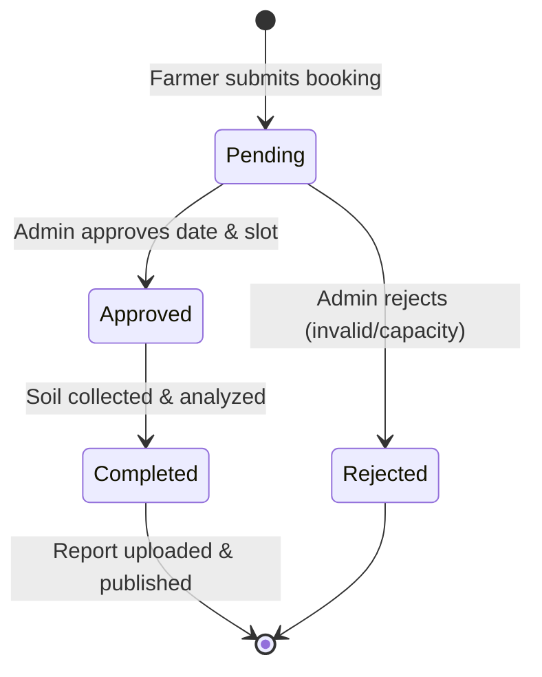

# Software Requirements Specification (SRS)
## Soil Testing Appointment & Report Access Portal

---

## 1. Functional Requirements (FR)

### FR-1: User Account & Authentication
- **FR-1.1:** The system shall allow new farmers to register an account by providing their full name, valid phone number, and a secure password.
- **FR-1.2:** Public registration must strictly assign the `farmer` role. No public request shall be permitted to create an account with the `admin` role.
- **FR-1.3:** Phone numbers must be unique across all registered users. Duplicate phone registrations must be rejected with an appropriate error message.
- **FR-1.4:** Passwords must be hashed using a secure one-way salted hashing algorithm before storage. Plaintext passwords must never be stored, logged, or serialized.
- **FR-1.5:** The system shall provide an authentication endpoint where users (farmers and administrators) can log in using their registered phone number and password.
- **FR-1.6:** Upon successful authentication, the system shall establish a secure session.
- **FR-1.7:** Users must be able to log out, terminating their current session.

### FR-2: Appointment Management
- **FR-2.1:** Authenticated farmers shall be able to submit a soil sample collection appointment request with the following information:
  - Land details (e.g., plot size, soil type, previous crops).
  - Physical address / field location.
  - Preferred collection date (`YYYY-MM-DD`).
  - Preferred collection time slot (`09:00-12:00` or `14:00-17:00`).
  - Optional special instructions or notes.
- **FR-2.2:** Every newly created appointment must automatically receive an initial status of `Pending`.
- **FR-2.3:** Authenticated farmers must be able to view a list of all appointments they have booked, along with each appointment's current status and timestamps.
- **FR-2.4:** Farmers must be restricted to viewing only their own appointments. They must never see appointments submitted by other farmers.
- **FR-2.5:** Authenticated administrators must be able to view all appointments across all farmers, with optional filtering by status (e.g., `Pending`, `Approved`, `Rejected`, `Completed`).
- **FR-2.6:** Administrators must be able to update an appointment's status following the permitted state transition rules.

### FR-3: Report Management
- **FR-3.1:** Administrators shall be able to upload an official soil test report in PDF format for an appointment that has reached the `Completed` status.
- **FR-3.2:** The system must restrict each appointment to at most one official report in this version. Duplicate uploads for the same appointment must be rejected.
- **FR-3.3:** The system must record report metadata: internal storage path, original filename, file size in bytes, SHA-256 checksum, administrator ID, and upload timestamp.
- **FR-3.4:** PDF files must be stored securely on the server outside public web server roots.
- **FR-3.5:** A report may be downloaded only by:
  - The farmer who owns the associated appointment.
  - An authenticated administrator.
- **FR-3.6:** Unauthorized users or other farmers attempting to access or download a report must be denied access with HTTP `403 Forbidden` or `404 Not Found`.

### FR-4: System Health & Diagnostics
- **FR-4.1:** The system shall provide a public `GET /api/health` endpoint returning a JSON confirmation that the web service is active.

---

## 2. Non-Functional Requirements (NFR)

### NFR-1: Security & Privacy
- **NFR-1.1 (Password Protection):** Passwords must be hashed using `scrypt` or `pbkdf2:sha256` via `werkzeug.security`.
- **NFR-1.2 (Session Security):** Sessions must use cryptographically signed HTTP-only cookies (`HttpOnly=True`, `SameSite='Lax'`, and `Secure=True` in production).
- **NFR-1.3 (Path Traversal Protection):** Uploaded files must be renamed to cryptographically random UUIDs on disk, never using client-supplied file paths.
- **NFR-1.4 (SQL Injection Prevention):** 100% of SQL queries must use parameterized placeholders (`?`). String interpolation or formatting in queries is strictly prohibited.
- **NFR-1.5 (Role & Ownership Enforcement):** Role checks and data ownership must be strictly verified on the backend in Python code, independent of database foreign keys.

### NFR-2: Performance & Concurrency
- **NFR-2.1:** Standard API responses (health check, appointment list, status updates) must respond in under 100 milliseconds under expected community portal traffic.
- **NFR-2.2:** SQLite must operate in Write-Ahead Logging (WAL) mode with a 5.0-second busy timeout to allow non-blocking concurrent reads during writes.
- **NFR-2.3:** Essential search columns (`farmer_id`, `status`) must be indexed to avoid full table scans.

### NFR-3: Data Integrity & Reliability
- **NFR-3.1:** SQLite foreign-key enforcement (`PRAGMA foreign_keys = ON;`) must be executed on every database connection.
- **NFR-3.2:** Database mutations must run inside transaction blocks (`with db:`) that automatically roll back on error.
- **NFR-3.3:** Referenced records must not be deleted (`ON DELETE RESTRICT`) to preserve historical auditability.

### NFR-4: Usability & Maintainability
- **NFR-4.1:** The web interface must be responsive across mobile handsets (360px+) and desktop displays.
- **NFR-4.2:** Code must follow PEP 8 standards, application factory patterns, and clear modular structure suitable for an academic portfolio.

---

## 3. User Roles and Permissions Matrix

| Capability | Public / Guest | Farmer | Administrator |
| :--- | :---: | :---: | :---: |
| Check Server Health (`/api/health`) | Allowed | Allowed | Allowed |
| Register Account | Allowed (Farmer role only) | Denied | Denied |
| Login / Logout | Allowed | Allowed | Allowed |
| Book Appointment | Denied | Allowed | Denied |
| View Own Appointments | Denied | Allowed | Allowed |
| View All Appointments | Denied | Denied | Allowed |
| Update Appointment Status | Denied | Denied | Allowed |
| Upload Soil Test Report | Denied | Denied | Allowed |
| Download Linked Report | Denied | Allowed (Own only) | Allowed (All) |

---

## 4. Appointment Lifecycle & State Machine

### State Transition Rules:
1. `Pending`: Initial status assigned upon creation.
2. `Approved`: Set by an Admin when field visit is confirmed.
3. `Rejected`: Set by an Admin if the address is out of range, details invalid, or slot unavailable. Terminal state.
4. `Completed`: Set by an Admin once field collection and lab processing are finalized. Prerequisite for report upload.

---

## 5. Input Validation Requirements

| Field | Type / Rule | Validation Criteria | Error Handling |
| :--- | :--- | :--- | :--- |
| `phone` | Text (E.164) | Must match pattern `^\+[1-9]\d{9,14}$` after stripping whitespace and hyphens. | HTTP 400 with message "Invalid phone number format." |
| `password` | Text | Minimum 8 characters; at least one letter and one digit. | HTTP 400 with message "Password must be at least 8 characters long." |
| `role` | Text | Must be strictly `'farmer'` or `'admin'`. Database CHECK constraint enforced. | Rejection on DB insert / HTTP 400. |
| `preferred_date` | Text (Date) | Must be valid calendar date in `YYYY-MM-DD` format. Must be today or a future date. | HTTP 400 with message "Appointment date cannot be in the past." |
| `preferred_time` | Text (Enum) | Must be strictly `'09:00-12:00'` or `'14:00-17:00'`. | HTTP 400 with message "Invalid time slot selected." |
| `status` | Text (Enum) | Must be strictly `'Pending'`, `'Approved'`, `'Rejected'`, or `'Completed'`. | HTTP 400 with message "Invalid appointment status." |
| `file` (Report) | Binary PDF | Must start with magic bytes `%PDF-`, have `.pdf` extension, size > 0 and <= 10MB. | HTTP 400 with specific file validation error. |

---

## 6. Definition of Done (DoD)

A feature or phase is declared **Done** only when:
1. **Implementation:** Code is implemented following the agreed architectural design.
2. **Security Checks:** Server-side role checks, parameterization, and path sanitization are enforced.
3. **Automated Testing:** Dedicated unit and integration tests are written using `pytest` and pass 100%.
4. **Documentation:** Relevant API contracts, schema updates, or README instructions are updated.
5. **No Regressions:** All existing tests continue to pass without errors or warnings.

