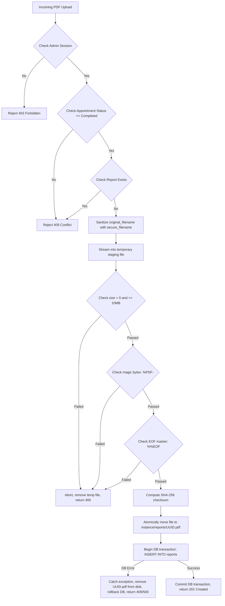

# Security & Privacy Policy Specification
## Soil Testing Appointment & Report Access Portal

---

## 1. Password Security & Hashing

- **Algorithm:** Passwords must be hashed using `werkzeug.security.generate_password_hash` utilizing modern, collision-resistant algorithms (`scrypt` or `pbkdf2:sha256`) with automatic unique cryptographic salting.
- **Verification:** Credential validation must strictly use `werkzeug.security.check_password_hash`.
- **Zero Plaintext Storage:** Plaintext passwords must never be stored in the database, logged to stdout/files, serialized in error tracebacks, or cached in session cookies.
- **Complexity Policy:** Passwords must be at least 8 characters long and contain both letters and digits.

---

## 2. Session Management & Cookie Security

- **Flask Signed Cookies:** Sessions use Flask's cryptographically signed cookie mechanism backed by the application's `SECRET_KEY`.
- **Cookie Security Attributes:**
  - `HttpOnly = True`: Blocks access to the session cookie via JavaScript, mitigating Cross-Site Scripting (XSS) session theft.
  - `SameSite = 'Lax'`: Prevents the cookie from being sent on cross-site requests, providing robust protection against Cross-Site Request Forgery (CSRF).
  - `Secure = True`: Enforced in production environments to guarantee cookies are transmitted exclusively over encrypted HTTPS connections.
- **Minimal Session Storage:** The session cookie contains only the minimum required identifier (`user_id`). The user's active role is validated against the database during authorization checks to ensure immediate revocation if an account's role changes.
- **Explicit Invalidation:** Logging out (`/api/auth/logout`) explicitly calls `session.clear()`, invalidating the cookie on the client.

---

## 3. Role-Based Access Control (RBAC) & Tenant Data Isolation

### 3.1 Server-Side Enforcement (Implemented in Phase 2)
SQLite foreign keys only verify referential integrity (that an ID exists in the parent table); **they do not verify user roles**. Therefore, RBAC is strictly enforced in Python service decorators in `app/auth.py`:

```python
# Implemented in app/auth.py:
def login_required(f):
    @wraps(f)
    def decorated_function(*args, **kwargs):
        user = get_current_user()
        if user is None:
            return error_response(code="UNAUTHENTICATED", message="Authentication required.", status_code=401)
        return f(*args, **kwargs)
    return decorated_function

def admin_required(f):
    @wraps(f)
    def decorated_function(*args, **kwargs):
        user = get_current_user()
        if user is None:
            return error_response(code="UNAUTHENTICATED", message="Authentication required.", status_code=401)
        if user["role"] != "admin":
            return error_response(code="FORBIDDEN", message="Admin privileges required.", status_code=403)
        return f(*args, **kwargs)
    return decorated_function

def farmer_required(f):
    @wraps(f)
    def decorated_function(*args, **kwargs):
        user = get_current_user()
        if user is None:
            return error_response(code="UNAUTHENTICATED", message="Authentication required.", status_code=401)
        if user["role"] != "farmer":
            return error_response(code="FORBIDDEN", message="Farmer privileges required.", status_code=403)
        return f(*args, **kwargs)
    return decorated_function
```

### 3.2 CSRF Protection Architecture (Implemented in Phase 2)
Because session authentication uses HTTP cookies, state-changing requests (`POST`, `PUT`, `PATCH`, `DELETE`) require Cross-Site Request Forgery (CSRF) protection:
- **Token Generation:** The server binds a cryptographically random token (`secrets.token_hex(32)`) to the user's session.
- **Frontend Contract:** Single-page frontend applications retrieve the active token via `GET /api/auth/csrf-token` upon page load and transmit it in the `X-CSRF-Token` HTTP header on all state-changing requests.
- **Constant-Time Verification:** The server compares the provided token with the session token using `secrets.compare_digest()`. If missing or mismatched, requests are rejected with HTTP 403 `CSRF_ERROR`.
- **Zero Heavy Dependencies:** Handled using native Python standard library (`secrets`) without requiring heavy form-handling frameworks like WTForms.

### 3.3 Rate Limiting Architecture & Future Targets
- **Identified Targets:** `POST /api/auth/login` and `POST /api/auth/register` are identified as primary targets for rate limiting to prevent brute-force password guessing and automated registration spam.
- **Architecture Strategy:** Rather than introducing Redis or Celery daemons, the portal will employ simple SQLite or in-memory sliding-window request tracking if community volume dictates in future phases. No premature infrastructure is introduced in Phase 2.

### 3.4 Farmer Tenant Data Isolation & Anti-IDOR Protections (Implemented in Phase 3)
Farmers must never access appointments or reports belonging to other farmers.
- **Server-Side Identity Binding:** In `POST /api/appointments`, the `farmer_id` is set strictly to `g.current_user["id"]` obtained from the active, verified session. Any client-provided `farmer_id` or `status` in the request body is discarded.
- **Enforced Status Immutability:** Newly created appointments are assigned `status = 'Pending'` by the server. Farmers cannot alter status to `Approved` or `Completed`; no client-side modification endpoint exists.
- **Tenant-Isolated Listing:** Appointment listing (`GET /api/appointments`) queries exclusively with `WHERE farmer_id = ?`:
  ```sql
  SELECT id, farmer_id, land_details, address, preferred_date, preferred_time, notes, status, created_at, updated_at
  FROM appointments
  WHERE farmer_id = ?
  ORDER BY created_at DESC, id DESC
  ```
  Query parameters attempting to specify another farmer ID are completely ignored.
- **Anti-IDOR Policy (Safe 404 Returns):** When requesting a single appointment (`GET /api/appointments/<int:id>`), the backend verifies:
  ```python
  if appointment is None or appointment["farmer_id"] != g.current_user["id"]:
      return error_response(code="NOT_FOUND", message="Appointment not found.", status_code=404)
  ```
  Returning HTTP 404 `NOT_FOUND` rather than HTTP 403 `FORBIDDEN` prevents attackers from enumerating or discovering valid appointment IDs belonging to other farmers.

### 3.5 Secure Administrator Provisioning *(Implemented in Phase 1)*
- **No Public Admin Registration:** Public registration via `/api/auth/register` (Phase 2) will strictly assign the `farmer` role. No request parameters can override this.
- **Dedicated CLI Provisioning:** Administrator accounts are created exclusively through the local CLI command: `flask init-admin` (implemented in `app/db.py`).
- **Interactive Hidden Password Prompt:** To prevent password leakage into shell history files (`.bash_history`, `.zsh_history`) or system process listings (`ps aux`), the CLI command prompts interactively with hidden input and confirmation:
  ```python
  password = click.prompt("Admin Password", hide_input=True, confirmation_prompt=True)
  ```
  Passwords are never accepted as plaintext command-line flags, printed, or logged.
- **E.164 Phone Normalization & Integrity Check:** The command validates that the phone conforms to standard E.164 (`^\+[1-9]\d{7,14}$`), rejects duplicate admin phones, and strictly rejects existing farmer phone numbers to ensure no farmer account can ever be promoted to admin.
- **Password Hashing:** Passwords are hashed using Werkzeug's `generate_password_hash` before database insertion. Output never reveals password hashes or secrets.

### 3.6 Administrative Authorization & State Transition Security *(Implemented in Phase 4)*
- **Strict Role Verification:** All administrative endpoints (`/api/admin/appointments/*`) require `@admin_required`, which reloads the active user role directly from SQLite to guarantee immediate revocation if permissions change. Unauthenticated requests receive HTTP 401; farmers receive HTTP 403.
- **State Machine Integrity:** The backend strictly controls status progression:
  - `Pending` → `Approved`
  - `Pending` → `Rejected`
  - `Approved` → `Completed`
  - `Rejected` and `Completed` are terminal states.
  Any invalid transition attempt returns HTTP 409 Conflict (`code: "CONFLICT"`).
- **Concurrency & Race Condition Defense:** Status updates use an atomic conditional SQL statement:
  ```sql
  UPDATE appointments
  SET status = ?, updated_at = CURRENT_TIMESTAMP
  WHERE id = ? AND status = ?;
  ```
  If `cursor.rowcount == 0`, the backend detects a concurrent state change between read and write, returning HTTP 409 Conflict rather than silently overwriting the updated record.
- **Zero Secret Exposure:** Joined queries returning farmer contact details (`farmer_name`, `farmer_phone`) strictly omit `password_hash` and authentication fields.
- **CSRF Enforcement:** `PATCH /api/admin/appointments/<int:id>/status` is protected by mandatory `X-CSRF-Token` validation against the admin's session.

---

## 4. SQL Injection Protection

- **100% Parameterized Queries:** Every database interaction must use SQLite's native `?` placeholder syntax:
  ```python
  # CORRECT:
  cursor.execute("SELECT * FROM users WHERE phone = ?", (phone,))
  
  # STRICTLY FORBIDDEN:
  cursor.execute(f"SELECT * FROM users WHERE phone = '{phone}'")
  ```
- String formatting, f-strings, and string concatenation for SQL queries are prohibited and will fail code review.

---

## 5. Secure PDF File Uploads & Private Storage *(Implemented in Phase 5)*



### 5.1 Defense-in-Depth File Validation
1. **Extension Check:** File must end with `.pdf`.
2. **MIME Type Check:** Content-Type must be `application/pdf` or `application/x-pdf`.
3. **Magic Byte Inspection:** File header must start with the standard PDF byte signature: `%PDF-`.
4. **End-of-File Marker:** File must terminate with the standard PDF trailer marker: `%%EOF`.
5. **Streaming Size Limit:** Enforced dynamically while reading 64 KB chunks up to 10 MB to prevent Denial of Service (DoS) memory exhaustion.
6. **Non-Empty Check:** File must be greater than 0 bytes.
7. **Validation Scope Note:** Signature and structural marker checks provide essential sanitization against arbitrary non-PDF uploads; they are lightweight validations and not a replacement for antivirus or full sandboxed PDF rendering.

### 5.2 Path Traversal & File Overwrite Prevention
- The client-supplied filename is **never** used as a disk storage path.
- `original_filename` is sanitized using `werkzeug.utils.secure_filename()` purely for download headers.
- Disk storage uses a random UUID: `instance/reports/<uuid4>.pdf`. This completely prevents `../` path traversal attacks, hidden directory escapes, and overwriting existing files.
- The `reports` table in SQLite stores only the relative basename (`<uuid4>.pdf`). Physical paths are never exposed in API responses.

### 5.3 Rollback & Cleanup on Failure
- If streaming aborts due to size or format errors, the temporary `.staging_<uuid>.tmp` file is deleted immediately.
- If a database insertion fails (e.g. concurrent race condition or constraint violation), the newly created UUID disk file is deleted in the `except` block, preventing orphaned files.

### 5.4 Secure Download Headers
When downloading reports via `/api/appointments/<id>/report/download` or `/api/admin/appointments/<id>/report/download`, responses enforce:
- `Content-Type: application/pdf`
- `Content-Disposition: attachment; filename="<original_filename>"`
- `X-Content-Type-Options: nosniff` (prevents MIME sniffing)
- `Cache-Control: private, no-cache, no-store, must-revalidate` (prevents intermediate caching)

### 5.5 Crash-Recovery Window & Safe Orphan-File Reconciliation
- **The Non-Atomic Boundary:** In standard OS environments, SQLite transactions and filesystem file moves cannot form a single distributed two-phase commit. If an abrupt process termination (e.g. `SIGKILL`, sudden power failure) occurs after `os.replace()` finishes but before `db.commit()` records the metadata, an unreferenced `<uuid4>.pdf` file could remain in `instance/reports/`.
- **Safe Reconciliation Strategy (Zero Heavy Daemons):**
  Rather than running background worker daemons (such as Celery or Redis), an administrator or scheduled maintenance task can safely audit the directory:
  1. Query active stored filenames from the database: `SELECT file_path FROM reports`.
  2. Scan all physical files in `instance/reports/` (ignoring `.staging_*.tmp` files currently in flight).
  3. Compute the unreferenced set: `orphans = disk_files - db_files`.
  4. Enforce an age threshold (e.g., file modification time > 1 hour) before removal, ensuring active concurrent uploads are never touched.
  5. Employ dry-run logging by default before permanently deleting orphan files.

---

## 6. Frontend Security, XSS Defense & Server-Side Route Access Control

### 6.1 Strict DOM Sanitization & XSS Defense (Implemented in Phase 6)
All user-controlled dynamic fields (farmer names, phone numbers, land details, field addresses, appointment notes, uploaded filenames, status indicators, and error/alert messages) undergo strict DOM neutralization:
- **`textContent` and `replaceChildren()` Usage:** Dynamic notification banners and validation error messages construct plain DOM text nodes (`span.textContent = ...`) rather than passing raw strings to `innerHTML`.
- **Entity Escaping in Table & Modal Templates:** Any string interpolated into template literals is processed through `escapeHtml()` which converts `&`, `<`, `>`, `"`, and `'` to safe HTML entities (`&amp;`, `&lt;`, `&gt;`, `&quot;`, `&#039;`).
- **Canary Verification:** Real browser testing with Google Chrome headless confirmed that injection vectors such as `<script>alert('xss')</script>` or `` are rendered as harmless plain text and canary execution flags remain unexecuted.

### 6.2 Server-Side Page Route Authorization
Page access control is enforced at the Flask view layer in `app/views.py`, not delegated solely to client-side JavaScript:
- **`/farmer` Route:** Inspects session with `get_current_user()`. Unauthenticated requests immediately issue an HTTP 302 redirect to `/login`. Requests with `role='admin'` are redirected to `/admin`.
- **`/admin` Route:** Inspects session with `get_current_user()`. Unauthenticated requests redirect to `/login`. Requests with `role='farmer'` are redirected to `/farmer`.
- **`/login` & `/register` Routes:** Authenticated users visiting auth entry points are automatically forwarded to their active role's dashboard.

### 6.3 Client-Side CSRF & Session Management
- **In-Memory Storage:** The CSRF token is stored in JavaScript memory (`API.csrfToken`), fetched upon initialization via `GET /api/auth/csrf-token`, and refreshed on authentication transitions.
- **Credential Dispatch:** All fetch requests enforce `credentials: 'same-origin'`.
- **Multipart Form Uploads:** When uploading PDF reports via `FormData`, fetch omits the `Content-Type` header so the browser automatically sets the correct `multipart/form-data; boundary=...`, while preserving the `X-CSRF-Token` header.
- **Session Expiration Handling:** API responses returning HTTP 401 trigger an immediate user notification and redirect to `/login` without infinite loops.

---

## 7. Environment Configuration & Secrets Management

- **`SECRET_KEY` Management:**
  - Loaded via `os.environ.get("SECRET_KEY")`.
  - In local development, defaults to a safe developer fallback.
  - In production, must be set via environment variable to a high-entropy 256-bit random key:
    ```bash
    python3 -c "import secrets; print(secrets.token_hex(32))"
    ```
- **Git Exclusion:** `.env`, `.secrets`, `instance/`, and `*.db` files are strictly excluded via `.gitignore`.

---

## 8. Safe Error Handling & Logging Rules

- **Client-Facing Errors:** API errors must return generic, actionable messages (e.g., `"Invalid credentials"`, `"Unable to process appointment"`) rather than raw database or Python exception traces.
- **Logging Prohibitions:**
  - Never log passwords or password hashes.
  - Never log full credit card or payment data (out of scope).
  - Mask phone numbers in production logs (e.g. `+91*****54321`).
  - Never log raw PDF byte streams.

---

## 9. Security Testing Checklist

- [x] **SQLi:** Attempt login and appointment search using SQL injection payloads (`' OR '1'='1`). Parameterized queries (`?`) verified across 100% of routes in `tests/test_auth.py` and `tests/test_appointments.py`.
- [x] **IDOR / Tenant Isolation:** Attempt to access Farmer A's appointment details using Farmer B's session. Anti-IDOR tenant isolation enforced with safe HTTP 404 responses verified in `tests/test_appointments.py` and `tests/test_reports.py`.
- [x] **Role Escalation:** Attempt to invoke `POST /api/admin/appointments/1/status` using a farmer session. Live database role authorization returns HTTP 403 Forbidden, verified in `tests/test_admin_appointments.py` and `tests/test_auth.py`.
- [x] **Public Admin Registration:** Attempt to register an account with `role: "admin"` via `POST /api/auth/register`. Enforces `role='farmer'` regardless of client payload, verified in `tests/test_auth.py`.
- [x] **Path Traversal:** Attempt report upload with filenames like `../../etc/passwd.pdf`. Storage path generated as unpredictable UUIDv4 (`<uuid4>.pdf`) in `instance/reports/`, verified in `tests/test_reports.py`.
- [x] **File Spoofing:** Attempt report upload with an executable or HTML file renamed to `.pdf`. Deep stream inspection verifies `%PDF-` header and `%%EOF` trailer markers, verified in `tests/test_reports.py`.
- [x] **Oversize Upload:** Attempt uploading an 11 MB file; verify that streaming aborts before loading into RAM. Verified via 10 MB payload check and 12 MB Flask `MAX_CONTENT_LENGTH` in `tests/test_reports.py`.
- [x] **CSRF:** Verify state-changing endpoints reject requests from untrusted origins without credentials or valid tokens. Double-submit in-memory token verified in `tests/test_auth.py` and `tests/test_reports.py`.

