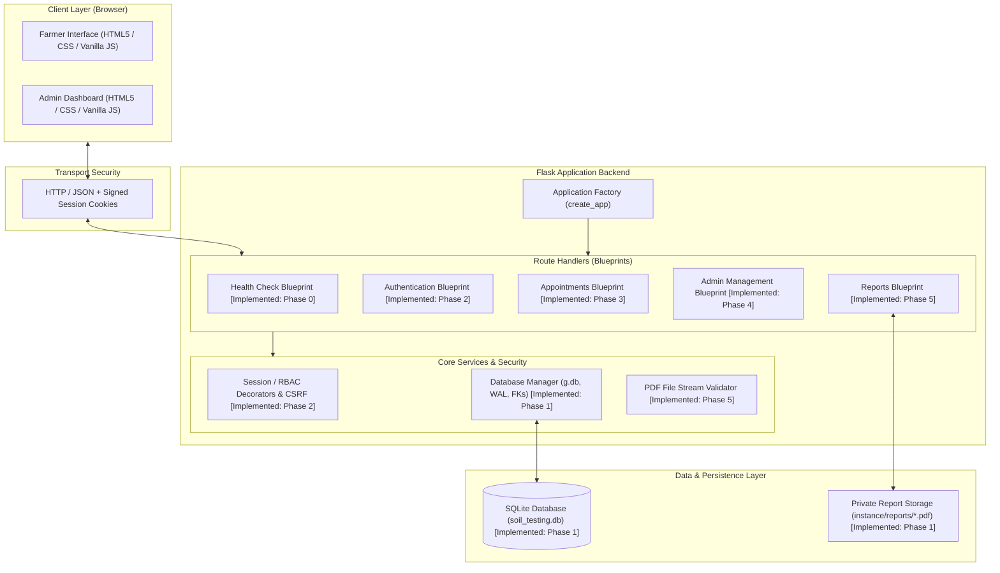

# System Architecture Specification
## Soil Testing Appointment & Report Access Portal

---

## 1. Technology Stack

| Layer | Technology | Version | Purpose & Rationale |
| :--- | :--- | :--- | :--- |
| **Backend Runtime** | Python | 3.10+ (tested on 3.15) | Modern, readable, standard programming environment. |
| **Web Framework** | Flask | 3.0+ | Lightweight, unopinionated WSGI micro-framework using blueprints and application factories. |
| **Relational Database** | SQLite | 3.x | Serverless, zero-configuration ACID database with WAL concurrency and foreign-key integrity. |
| **Frontend Markup** | HTML5 | Standard | Semantic, mobile-friendly markup structure. |
| **Styling** | CSS3 | Standard | Lightweight responsive grid and flexbox layout without heavy framework overhead. |
| **Client Scripting** | JavaScript | ES6+ Vanilla | Browser-native `fetch()` API, DOM updates, and client validation without complex build tools. |
| **Test Suite** | pytest | 8.0+ | Automated test framework for unit, integration, and security test execution. |
| **File Storage** | Local Filesystem | OS-level | Secure private folder (`instance/reports/`) outside web document root. |

---

## 2. High-Level Architecture Diagram

---

## 3. Implemented vs. Planned Components

| Component | Status | Location in Codebase | Description |
| :--- | :---: | :--- | :--- |
| **Application Factory** | **Implemented (Phase 0)** | `app/__init__.py` | Creates and configures Flask instance with `instance_relative_config=True`. |
| **Health Check API** | **Implemented (Phase 0)** | `app/routes.py` | `GET /api/health` returning JSON service status. |
| **Phase 0 Health Tests** | **Implemented (Phase 0)** | `tests/test_health.py` | 2 automated tests verifying health check status code 200 and method rejection. |
| **Database Layer & Schema** | **Implemented (Phase 1)** | `app/db.py`, `app/schema.sql` | `get_db()`, `close_db()`, `init_db()`, WAL mode, `flask init-db`, and `flask init-admin` CLI commands. |
| **Database Unit & CLI Tests** | **Implemented (Phase 1)** | `tests/test_db.py` | 23 automated tests covering schema constraints, foreign keys, transaction rollbacks, connection teardown, and admin CLI provisioning. |
| **Instance Storage** | **Implemented (Phase 1)** | `instance/reports/` | Directory structure created and git-ignored for private PDF files and SQLite DB. |
| **Authentication & RBAC API** | **Implemented (Phase 2)** | `app/auth.py` | Registration, login, logout, me endpoint, password hashing, session management, CSRF validation, and RBAC decorators. |
| **Authentication Tests** | **Implemented (Phase 2)** | `tests/test_auth.py` | 24 automated tests covering registration, login, session lifecycle, role reload, logout, authorization decorators, and CSRF protection. |
| **Farmer Appointment API** | **Implemented (Phase 3)** | `app/appointments.py` | Creation of booking, server-enforced Pending status, tenant-isolated listing, detail view, anti-IDOR checks. |
| **Farmer Appointment Tests** | **Implemented (Phase 3)** | `tests/test_appointments.py` | 18 automated tests covering appointment booking, date/slot validations, lengths, tenant data isolation, IDOR defense, and RBAC. |
| **Admin Management API** | **Implemented (Phase 4)** | `app/admin.py` | List all appointments with pagination & status filters, view single appointment, manage status transitions (Approved, Rejected, Completed) with concurrency guard. |
| **Admin Management Tests** | **Implemented (Phase 4)** | `tests/test_admin_appointments.py` | 32 automated tests covering admin listing, status filtering, bounded pagination, state machine transitions, concurrency, RBAC, CSRF, and timezone validation. |
| **Report Upload & Download** | **Implemented (Phase 5)** | `app/reports.py` | Streaming PDF upload, SHA-256 calculation, UUID storage, and authenticated download for farmers and admins. |
| **Report Tests** | **Implemented (Phase 5)** | `tests/test_reports.py` | 42 automated tests covering admin upload, status rules, file validations (magic bytes, %%EOF, 10MB limit), failure injection, and anti-IDOR downloads. |
| **Frontend Web Views & Assets** | **Implemented (Phase 6)** | `app/templates/`, `app/static/`, `app/views.py` | HTML5 Jinja2 templates, accessible CSS styles, and vanilla JavaScript client for farmers and administrators. |
| **Frontend & E2E Integration Tests** | **Implemented (Phase 6)** | `tests/test_views.py` | 11 automated tests verifying HTML rendering, static assets serving, server route protection, and end-to-end user workflows. |
| **System Verification & Quality Review** | **Implemented (Phase 7)** | `docs/INTERVIEW_PREPARATION.md`, browser automation | Real browser CDP verification (Farmer 1–18, Admin 1–21), responsive viewports (360px–1366px), clean setup validation, 152 automated tests passing. |

---

## 4. Architectural Layers & Separation of Concerns

### 4.1 Presentation Layer (Frontend)
- Communicates with the backend exclusively via RESTful HTTP JSON endpoints and file downloads.
- Employs standard browser credentials (`credentials: 'include'`) to pass session cookies automatically.
- Validates user input in real-time (phone format, non-empty fields) before dispatching network requests, improving user experience.

### 4.2 Application Layer (Flask Blueprints)
- Routes are organized into modular Flask Blueprints:
  - `health`: Server status and ping endpoint.
  - `auth`: Handles user registration, credentials check, and session lifecycle.
  - `appointments`: Enforces business rules and validates booking fields.
  - `reports`: Handles secure PDF file streaming, checksumming, and access checks.
- Application Factory (`create_app` in `app/__init__.py`) dynamically loads configuration and registers all blueprints.

### 4.3 Database Connection & Lifecyle Management
- **Per-Request Connection:** The database connection is instantiated lazily via `get_db()` and bound to Flask's request context `g.db`. Subsequent calls within the same request reuse this connection without overhead.
- **Teardown Cleanup:** Flask automatically invokes `close_db()` via `@app.teardown_appcontext`, closing open handles when the request finishes.
- **Foreign Keys:** Every connection executes `PRAGMA foreign_keys = ON;` to enforce referential constraints.
- **Write-Ahead Logging (WAL):** Configured on database initialization (`PRAGMA journal_mode = WAL;`) to allow multiple readers to read concurrently while a writer writes.
- **Busy Timeout:** Configured to `5000` ms so concurrent transactions wait for locks rather than failing prematurely.

### 4.4 File Storage Architecture
- PDF test reports are saved in `instance/reports/` using random UUID4 filenames (e.g. `c4b6...-..pdf`).
- **No Direct Static Serving:** The `instance/` folder is not exposed through Flask's static folder or web server static routes.
- **Controlled Streaming:** File retrieval passes through the authenticated route `GET /api/reports/<id>/download`, which validates user permissions before invoking Flask's `send_file()` with appropriate `Content-Disposition` and `Content-Type: application/pdf` headers.

