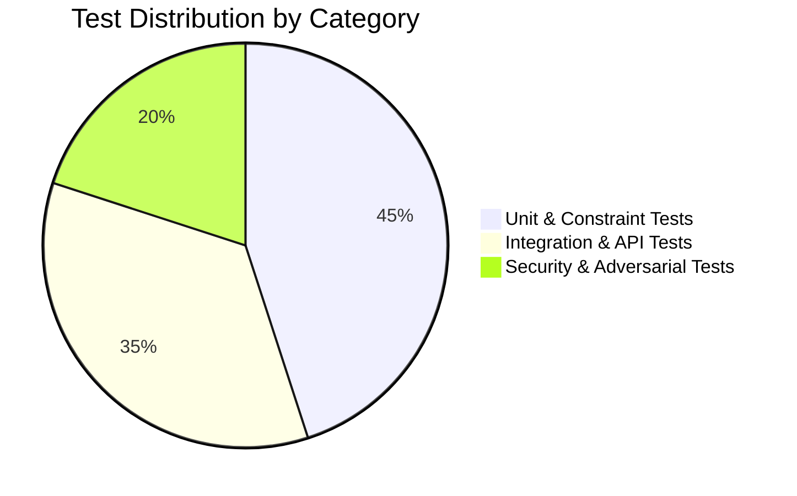

# Testing Strategy & Test Plan Specification
## Soil Testing Appointment & Report Access Portal

---

## 1. Testing Philosophy & Test Pyramid

The project employs an automated, test-driven approach using `pytest`. Every phase must have corresponding automated tests before being marked complete.



- **Unit Tests:** Fast, isolated tests targeting schema constraints, data validators (phone, date, time), and utility functions.
- **Integration Tests:** End-to-end endpoint tests verifying HTTP status codes, request parsing, session cookies, and database state transitions.
- **Security & Adversarial Tests:** Explicit attempts to bypass role boundaries, access other users' data, inject malicious SQL, or traverse directory paths.

---

## 2. Test Environment & Database Isolation

- **Zero Production Data Mutation:** Tests must never alter, read, or connect to the actual development or production database in `instance/soil_testing.db`.
- **Per-Test Temporary Databases:** Test fixtures in `tests/test_db.py` (and future test modules) use Python's `tempfile.TemporaryDirectory()` to create a fresh, isolated SQLite file for every test run:
  ```python
  @pytest.fixture
  def app_and_db():
      with tempfile.TemporaryDirectory() as temp_dir:
          db_path = os.path.join(temp_dir, "test_soil_testing.db")
          app = create_app({"TESTING": True, "DATABASE": db_path})
          with app.app_context():
              init_db()
          yield app, db_path
  ```
- **Cleanup Guarantee:** When a test completes, the temporary directory and all associated database journal files are automatically deleted by the operating system.

---

## 3. Test Categories & Implementation Matrix

### 3.1 Phase 0 Implemented Tests (2 Tests Passing)
These tests verify that the Flask application factory and base API routing function correctly.

| Test Module | Test Name | Target / Purpose | Result |
| :--- | :--- | :--- | :---: |
| `tests/test_health.py` | `test_health_check_success` | Verifies `GET /api/health` returns HTTP 200 with JSON status. | **PASS** |
| `tests/test_health.py` | `test_health_check_method_not_allowed` | Verifies `POST /api/health` returns HTTP 405 Method Not Allowed. | **PASS** |

---

### 3.2 Phase 1 Database Foundation Tests (23 Tests Passing)
These tests verify that database schema, constraints, foreign keys, transaction rollbacks, connection teardown, and admin provisioning function properly.

| Test Module | Test Name | Target / Purpose | Result |
| :--- | :--- | :--- | :---: |
| `tests/test_db.py` | `test_init_db_creates_tables_and_indexes` | Confirms `users`, `appointments`, `reports` tables and indexes exist. | **PASS** |
| `tests/test_db.py` | `test_init_db_repeated_execution_is_safe` | Confirms calling `init_db()` repeatedly preserves existing records. | **PASS** |
| `tests/test_db.py` | `test_init_db_cli_command` | Tests `flask init-db` CLI command execution. | **PASS** |
| `tests/test_db.py` | `test_unique_phone_constraint` | Confirms duplicate phone numbers raise `sqlite3.IntegrityError`. | **PASS** |
| `tests/test_db.py` | `test_valid_and_invalid_user_roles` | Checks `role IN ('farmer', 'admin')` CHECK constraint. | **PASS** |
| `tests/test_db.py` | `test_valid_and_invalid_appointment_statuses`| Checks `status IN ('Pending', 'Approved', 'Rejected', 'Completed')`. | **PASS** |
| `tests/test_db.py` | `test_valid_and_invalid_time_slots` | Checks `preferred_time IN ('09:00-12:00', '14:00-17:00')`. | **PASS** |
| `tests/test_db.py` | `test_foreign_key_enforcement_on_insert` | Confirms foreign key enforcement on invalid `farmer_id` and `appointment_id`. | **PASS** |
| `tests/test_db.py` | `test_foreign_key_on_delete_restrict` | Confirms `ON DELETE RESTRICT` prevents deleting referenced parent records. | **PASS** |
| `tests/test_db.py` | `test_admin_deletion_restricted_when_reports_exist` | Confirms `ON DELETE RESTRICT` on `uploaded_by` blocks admin deletion. | **PASS** |
| `tests/test_db.py` | `test_unique_report_per_appointment` | Confirms `UNIQUE(appointment_id)` prevents duplicate reports. | **PASS** |
| `tests/test_db.py` | `test_unique_report_file_path` | Confirms `UNIQUE(file_path)` prevents report storage path collisions. | **PASS** |
| `tests/test_db.py` | `test_positive_file_size_constraint` | Confirms `CHECK (file_size_bytes > 0)` rejects 0 and negative sizes. | **PASS** |
| `tests/test_db.py` | `test_transaction_rollback_on_error` | Confirms failed transactions roll back changes completely. | **PASS** |
| `tests/test_db.py` | `test_db_connection_cleanup_on_teardown` | Verifies connection closes upon context exit (`ProgrammingError`). | **PASS** |
| `tests/test_db.py` | `test_test_database_isolation` | Verifies multiple test apps do not share database state. | **PASS** |
| `tests/test_db.py` | `test_init_admin_cli_success` | Tests admin creation with password hashing and zero secret output leakage. | **PASS** |
| `tests/test_db.py` | `test_init_admin_cli_rejects_duplicate_admin` | Confirms duplicate admin phone numbers are rejected. | **PASS** |
| `tests/test_db.py` | `test_init_admin_cli_never_promotes_farmer` | Confirms farmer accounts are never silently promoted to admin. | **PASS** |
| `tests/test_db.py` | `test_init_admin_cli_rejects_invalid_phone` | Confirms invalid E.164 phone formats are rejected. | **PASS** |
| `tests/test_db.py` | `test_init_admin_cli_rejects_empty_name` | Confirms empty or whitespace admin names are rejected. | **PASS** |
| `tests/test_db.py` | `test_init_admin_cli_rejects_mismatched_password` | Confirms confirmation password mismatches are rejected. | **PASS** |
| `tests/test_db.py` | `test_init_admin_cli_rejects_short_password` | Confirms passwords under 8 characters are rejected. | **PASS** |

---

### 3.3 Phase 2 Authentication & Authorization Tests (24 Tests Passing)
These tests verify farmer registration, login, session establishment, role-based authorization decorators, and CSRF protection.

| Test Module | Test Name | Target / Purpose | Result |
| :--- | :--- | :--- | :---: |
| `tests/test_auth.py` | `test_csrf_missing_token_on_post_rejected` | Confirms POST requests without CSRF token return HTTP 403. | **PASS** |
| `tests/test_auth.py` | `test_csrf_invalid_token_rejected` | Confirms POST requests with invalid CSRF token return HTTP 403. | **PASS** |
| `tests/test_auth.py` | `test_csrf_safe_get_requests_usable_without_token` | Confirms safe GET requests do not require a CSRF token. | **PASS** |
| `tests/test_auth.py` | `test_register_farmer_success` | Confirms farmer registration succeeds (201) and sets role='farmer'. | **PASS** |
| `tests/test_auth.py` | `test_register_missing_or_empty_name` | Confirms missing or whitespace-only name returns HTTP 400. | **PASS** |
| `tests/test_auth.py` | `test_register_invalid_or_non_e164_phone` | Confirms non-E.164 phone formats return HTTP 400. | **PASS** |
| `tests/test_auth.py` | `test_register_missing_or_short_password` | Confirms passwords under 8 characters return HTTP 400. | **PASS** |
| `tests/test_auth.py` | `test_register_duplicate_phone_rejected` | Confirms duplicate phone registration returns HTTP 409 Conflict. | **PASS** |
| `tests/test_auth.py` | `test_register_client_cannot_escalate_to_admin` | Confirms client-passed role='admin' is ignored; role is 'farmer'. | **PASS** |
| `tests/test_auth.py` | `test_login_farmer_success` | Confirms farmer login returns 200, sets session cookie, no password leaks. | **PASS** |
| `tests/test_auth.py` | `test_login_admin_success` | Confirms admin login succeeds and returns user info with role='admin'. | **PASS** |
| `tests/test_auth.py` | `test_login_wrong_password_generic_error` | Confirms wrong password returns generic 401 without account leakage. | **PASS** |
| `tests/test_auth.py` | `test_login_unknown_phone_generic_error` | Confirms unknown phone returns generic 401 identical to wrong password. | **PASS** |
| `tests/test_auth.py` | `test_login_missing_fields` | Confirms missing phone or password returns HTTP 400. | **PASS** |
| `tests/test_auth.py` | `test_me_unauthenticated` | Confirms /api/auth/me returns authenticated=False when logged out. | **PASS** |
| `tests/test_auth.py` | `test_me_authenticated_farmer` | Confirms /api/auth/me returns authenticated=True and farmer info. | **PASS** |
| `tests/test_auth.py` | `test_me_authenticated_admin` | Confirms /api/auth/me returns authenticated=True and admin info. | **PASS** |
| `tests/test_auth.py` | `test_me_role_reloaded_from_database` | Confirms role updates in DB take immediate effect on /api/auth/me. | **PASS** |
| `tests/test_auth.py` | `test_me_deleted_user_session_cleared_safely` | Confirms stale sessions for deleted users are safely cleared. | **PASS** |
| `tests/test_auth.py` | `test_logout_success_and_clears_session` | Confirms /api/auth/logout clears session and me returns unauthenticated. | **PASS** |
| `tests/test_auth.py` | `test_logout_while_already_logged_out_is_safe` | Confirms logout when already logged out is safe and idempotent. | **PASS** |
| `tests/test_auth.py` | `test_authorization_unauthenticated_rejected` | Confirms unauthenticated requests to protected endpoints return 401. | **PASS** |
| `tests/test_auth.py` | `test_authorization_farmer_cannot_access_admin_only` | Confirms farmer accessing admin-only endpoint receives 403 Forbidden. | **PASS** |
| `tests/test_auth.py` | `test_authorization_admin_can_access_admin_only` | Confirms admin accessing admin-only endpoint succeeds (200). | **PASS** |

---

### 3.4 Phase 3 Farmer Appointment API Tests (18 Tests Passing)
These tests verify farmer appointment creation, date and time slot validations, string length constraints, Pending status enforcement, farmer ownership isolation, anti-IDOR protections, and CSRF enforcement.

| Test Module | Test Name | Target / Purpose | Result |
| :--- | :--- | :--- | :---: |
| `tests/test_appointments.py` | `test_create_appointment_success` | Confirms successful appointment creation returns HTTP 201 with clean fields. | **PASS** |
| `tests/test_appointments.py` | `test_create_appointment_status_is_always_pending` | Confirms client-passed status is ignored; server always assigns 'Pending'. | **PASS** |
| `tests/test_appointments.py` | `test_create_appointment_farmer_id_cannot_be_spoofed` | Confirms client-passed farmer_id is ignored; session farmer_id is strictly used. | **PASS** |
| `tests/test_appointments.py` | `test_create_appointment_missing_required_fields` | Confirms missing required fields return HTTP 400 with VALIDATION_ERROR. | **PASS** |
| `tests/test_appointments.py` | `test_create_appointment_whitespace_only_fields_rejected` | Confirms whitespace-only land_details and address are rejected with HTTP 400. | **PASS** |
| `tests/test_appointments.py` | `test_create_appointment_excessive_lengths_rejected` | Confirms strings over 500 characters (or notes over 1000) return HTTP 400. | **PASS** |
| `tests/test_appointments.py` | `test_create_appointment_date_validations` | Confirms invalid formats, non-existent dates (e.g. Feb 31), and past dates are rejected. | **PASS** |
| `tests/test_appointments.py` | `test_create_appointment_time_slots` | Confirms only '09:00-12:00' and '14:00-17:00' are accepted; invalid slots return HTTP 400. | **PASS** |
| `tests/test_appointments.py` | `test_create_appointment_optional_notes` | Confirms optional notes can be omitted or provided; stripped properly. | **PASS** |
| `tests/test_appointments.py` | `test_create_appointment_csrf_enforced` | Confirms missing CSRF token on POST /api/appointments returns HTTP 403. | **PASS** |
| `tests/test_appointments.py` | `test_unauthenticated_requests_rejected` | Confirms unauthenticated requests to appointment endpoints return HTTP 401. | **PASS** |
| `tests/test_appointments.py` | `test_admin_cannot_use_farmer_appointment_endpoints` | Confirms admin user receives HTTP 403 Forbidden on farmer appointment routes. | **PASS** |
| `tests/test_appointments.py` | `test_list_appointments_empty` | Confirms newly registered farmer with no bookings receives an empty list. | **PASS** |
| `tests/test_appointments.py` | `test_list_appointments_returns_only_own_appointments` | Confirms Farmer A sees only Farmer A's appointments and not Farmer B's. | **PASS** |
| `tests/test_appointments.py` | `test_view_own_appointment_success` | Confirms farmer can view details of their own appointment (HTTP 200). | **PASS** |
| `tests/test_appointments.py` | `test_idor_farmer_cannot_view_another_farmers_appointment` | Anti-IDOR: Confirms Farmer B querying Farmer A's appointment ID receives safe 404. | **PASS** |
| `tests/test_appointments.py` | `test_view_nonexistent_appointment_returns_404` | Confirms querying a non-existent appointment ID returns HTTP 404. | **PASS** |
| `tests/test_appointments.py` | `test_no_unauthorized_modification_endpoint_exists` | Confirms farmer cannot modify appointments or change status via PATCH/PUT/DELETE. | **PASS** |

---

### 3.5 Phase 4 Admin Appointment Management Tests (32 Tests Passing)
These tests verify admin appointment listing across all farmers, status filtering, bounded pagination, single-appointment detail retrieval, state machine transitions, concurrent collision safety, RBAC authorization, CSRF protection, and Asia/Kolkata timezone date validation.

| Test Module | Test Name | Target / Purpose | Result |
| :--- | :--- | :--- | :---: |
| `tests/test_admin_appointments.py` | `test_admin_list_appointments_empty` | Confirms admin sees empty list and total_count=0 when no appointments exist. | **PASS** |
| `tests/test_admin_appointments.py` | `test_admin_list_appointments_multiple_farmers` | Confirms admin receives appointments from all farmers with joined farmer details. | **PASS** |
| `tests/test_admin_appointments.py` | `test_admin_list_status_filters` | Confirms ?status= filter isolates Pending, Approved, Rejected, Completed. | **PASS** |
| `tests/test_admin_appointments.py` | `test_admin_list_invalid_status_filter_returns_400` | Confirms unsupported status query parameter returns HTTP 400. | **PASS** |
| `tests/test_admin_appointments.py` | `test_admin_list_deterministic_ordering` | Confirms ordering strictly obeys created_at DESC, id DESC. | **PASS** |
| `tests/test_admin_appointments.py` | `test_admin_list_pagination` | Confirms page and per_page split records cleanly across pages without overlap. | **PASS** |
| `tests/test_admin_appointments.py` | `test_admin_list_pagination_invalid_parameters` | Confirms invalid page (<=0, string) or per_page (<=0, >100, string) returns 400. | **PASS** |
| `tests/test_admin_appointments.py` | `test_admin_get_appointment_details_success` | Confirms admin retrieves single appointment details with joined farmer info. | **PASS** |
| `tests/test_admin_appointments.py` | `test_admin_get_appointment_details_not_found` | Confirms querying a non-existent appointment returns HTTP 404. | **PASS** |
| `tests/test_admin_appointments.py` | `test_transition_pending_to_approved` | Confirms valid transition from Pending to Approved (HTTP 200). | **PASS** |
| `tests/test_admin_appointments.py` | `test_transition_pending_to_rejected` | Confirms valid transition from Pending to Rejected (HTTP 200). | **PASS** |
| `tests/test_admin_appointments.py` | `test_transition_approved_to_completed` | Confirms valid transition from Approved to Completed (HTTP 200). | **PASS** |
| `tests/test_admin_appointments.py` | `test_disallowed_status_transitions_return_409` | Confirms all invalid transitions (9 distinct state combinations) return HTTP 409. | **PASS** |
| `tests/test_admin_appointments.py` | `test_transition_unsupported_status_returns_400` | Confirms unknown status values return HTTP 400 VALIDATION_ERROR. | **PASS** |
| `tests/test_admin_appointments.py` | `test_transition_missing_or_empty_status_returns_400` | Confirms missing, non-string, or empty status returns HTTP 400. | **PASS** |
| `tests/test_admin_appointments.py` | `test_transition_malformed_json_returns_400` | Confirms non-JSON or malformed payload returns HTTP 400. | **PASS** |
| `tests/test_admin_appointments.py` | `test_transition_nonexistent_appointment_returns_404` | Confirms updating status of non-existent appointment returns HTTP 404. | **PASS** |
| `tests/test_admin_appointments.py` | `test_transition_same_status_is_successful_noop` | Confirms same-status request succeeds with 200 and preserves updated_at. | **PASS** |
| `tests/test_admin_appointments.py` | `test_transition_updates_updated_at_timestamp` | Confirms real status changes explicitly update updated_at timestamp. | **PASS** |
| `tests/test_admin_appointments.py` | `test_transition_concurrency_safe_conditional_update` | Confirms atomic conditional update detects concurrent collisions (HTTP 409). | **PASS** |
| `tests/test_admin_appointments.py` | `test_unauthenticated_requests_rejected` | Confirms unauthenticated callers receive HTTP 401 on all admin routes. | **PASS** |
| `tests/test_admin_appointments.py` | `test_farmer_cannot_access_admin_endpoints` | Confirms farmer session receives HTTP 403 Forbidden on all admin routes. | **PASS** |
| `tests/test_admin_appointments.py` | `test_admin_patch_status_csrf_protection` | Confirms missing or invalid CSRF token on PATCH status returns HTTP 403. | **PASS** |
| `tests/test_admin_appointments.py` | `test_kolkata_timezone_date_validation` | Confirms appointment date validation adheres to Asia/Kolkata calendar date. | **PASS** |

---

### 3.6 Phase 5 Report Upload & Access Tests (42 Tests Passing)
These tests verify administrative PDF upload for completed appointments, defense-in-depth PDF validations (magic bytes `%PDF-`, end marker `%%EOF`, 10MB streaming limit, extension, MIME), SHA-256 calculation, UUID-based storage filenames, private report storage, farmer metadata retrieval, farmer downloads, anti-IDOR protections, admin audits, CSRF protection, failure injection handling (staging write, atomic move, DB insert, DB commit), atomic cleanups, concurrent upload serialization, request-size limits (`MAX_CONTENT_LENGTH`), and filename sanitization edge cases.

| Test Module | Test Name | Target / Purpose | Result |
| :--- | :--- | :--- | :---: |
| `tests/test_reports.py` | `test_admin_upload_report_success` | Confirms admin uploads valid PDF; returns 201, UUID filename, and exact SHA-256. | **PASS** |
| `tests/test_reports.py` | `test_upload_nonexistent_appointment_returns_404` | Confirms upload for non-existent appointment returns HTTP 404. | **PASS** |
| `tests/test_reports.py` | `test_upload_for_non_completed_appointment_returns_409` | Confirms Pending, Approved, and Rejected appointments reject report upload (409). | **PASS** |
| `tests/test_reports.py` | `test_upload_duplicate_report_returns_409` | Confirms second upload for same appointment returns HTTP 409 Conflict. | **PASS** |
| `tests/test_reports.py` | `test_upload_missing_file_field` | Confirms missing 'file' field in multipart form data returns HTTP 400. | **PASS** |
| `tests/test_reports.py` | `test_upload_empty_file_rejected` | Confirms 0-byte file is rejected (400) and staging files deleted. | **PASS** |
| `tests/test_reports.py` | `test_upload_non_pdf_extension_rejected` | Confirms non-.pdf extensions (.txt, .png, .exe) return HTTP 400. | **PASS** |
| `tests/test_reports.py` | `test_upload_invalid_mime_type_rejected` | Confirms non-PDF MIME types return HTTP 400. | **PASS** |
| `tests/test_reports.py` | `test_upload_invalid_pdf_signature_rejected` | Confirms files missing '%PDF-' header signature return HTTP 400. | **PASS** |
| `tests/test_reports.py` | `test_upload_missing_eof_marker_rejected` | Confirms files missing '%%EOF' end marker return HTTP 400. | **PASS** |
| `tests/test_reports.py` | `test_upload_exceeding_10mb_rejected` | Confirms files > 10MB are aborted during streaming with HTTP 400. | **PASS** |
| `tests/test_reports.py` | `test_upload_path_traversal_filename_sanitized` | Confirms original filenames with '../' are safely sanitized for metadata. | **PASS** |
| `tests/test_reports.py` | `test_farmer_view_own_report_metadata_success` | Confirms farmer can view report metadata for own completed appointment. | **PASS** |
| `tests/test_reports.py` | `test_farmer_download_own_report_success` | Confirms farmer downloads PDF with nosniff, attachment, and no-store headers. | **PASS** |
| `tests/test_reports.py` | `test_idor_farmer_cannot_access_or_download_another_farmers_report` | Anti-IDOR: Farmer B querying Farmer A report receives safe HTTP 404. | **PASS** |
| `tests/test_reports.py` | `test_farmer_report_endpoints_when_no_report_exists_returns_404` | Confirms 404 returned when appointment has no uploaded report. | **PASS** |
| `tests/test_reports.py` | `test_admin_view_and_download_report_success` | Confirms admin can inspect metadata and download any report for audit. | **PASS** |
| `tests/test_reports.py` | `test_admin_report_endpoints_nonexistent_or_missing_returns_404` | Confirms 404 returned to admin for missing appointments or missing reports. | **PASS** |
| `tests/test_reports.py` | `test_unauthenticated_requests_rejected` | Confirms unauthenticated requests to report endpoints return HTTP 401. | **PASS** |
| `tests/test_reports.py` | `test_farmer_cannot_access_admin_report_endpoints` | Confirms farmer attempting admin upload or download receives HTTP 403. | **PASS** |
| `tests/test_reports.py` | `test_admin_cannot_access_farmer_report_endpoints` | Confirms admin attempting farmer report routes receives HTTP 403. | **PASS** |
| `tests/test_reports.py` | `test_admin_upload_report_csrf_protection` | Confirms missing or invalid CSRF token on upload returns HTTP 403. | **PASS** |
| `tests/test_reports.py` | `test_missing_disk_file_during_download_returns_safe_error` | Confirms missing physical file returns safe error without leaking server path. | **PASS** |
| `tests/test_reports.py` | `test_failure_injection_staging_write_error` | Confirms disk write failure during staging removes temporary file and returns 500. | **PASS** |
| `tests/test_reports.py` | `test_failure_injection_atomic_move_error` | Confirms atomic rename failure cleans staging file and returns 500. | **PASS** |
| `tests/test_reports.py` | `test_failure_injection_db_insert_error_cleans_up_file` | Confirms DB insert error deletes moved target file and returns 500 with 0 DB rows. | **PASS** |
| `tests/test_reports.py` | `test_failure_injection_db_integrity_error_cleans_up_file` | Confirms DB collision/IntegrityError deletes moved file and returns HTTP 409. | **PASS** |
| `tests/test_reports.py` | `test_failure_injection_db_commit_error_cleans_up_file` | Confirms DB commit failure deletes moved file, rolls back transaction, and returns 500. | **PASS** |
| `tests/test_reports.py` | `test_concurrent_uploads_prevent_duplicate_reports` | Confirms 2 concurrent uploads serialize: exactly 1 succeeds (201), 1 conflicts (409), 1 file on disk. | **PASS** |
| `tests/test_reports.py` | `test_request_entity_too_large_rejected_by_max_content_length` | Confirms requests > 12MB trigger HTTP 413 PAYLOAD_TOO_LARGE before processing. | **PASS** |
| `tests/test_reports.py` | `test_upload_valid_file_within_max_content_length` | Confirms valid 1MB PDF within limits succeeds with HTTP 201. | **PASS** |
| `tests/test_reports.py` | `test_filename_safety_edge_cases_and_fallbacks` | Confirms 9 filename sanitization edge cases produce safe, non-empty `.pdf` names. | **PASS** |

---

### 3.7 Phase 6 Frontend & E2E Integration Tests (11 Tests Passing)
These tests verify semantic HTML page rendering, server-side page authorization redirects, static asset serving (`style.css`, `api.js`, `farmer.js`, `admin.js`), XSS resilience, and complete end-to-end user workflows for both farmers and administrators.

| Test Module | Test Name | Target / Purpose | Result |
| :--- | :--- | :--- | :---: |
| `tests/test_views.py` | `test_render_index_page` | Confirms `GET /` renders index.html with portal branding, health status, and scripts. | **PASS** |
| `tests/test_views.py` | `test_render_register_page` | Confirms `GET /register` renders register.html with farmer registration form. | **PASS** |
| `tests/test_views.py` | `test_render_login_page` | Confirms `GET /login` renders login.html with phone/password credentials form. | **PASS** |
| `tests/test_views.py` | `test_render_farmer_page_unauthenticated_redirects` | Confirms unauthenticated access to `/farmer` redirects (302) to `/login`. | **PASS** |
| `tests/test_views.py` | `test_render_admin_page_unauthenticated_redirects` | Confirms unauthenticated access to `/admin` redirects (302) to `/login`. | **PASS** |
| `tests/test_views.py` | `test_render_farmer_page_authenticated` | Confirms authenticated farmer renders `/farmer` (200), and `/admin` redirects to `/farmer`. | **PASS** |
| `tests/test_views.py` | `test_render_admin_page_authenticated` | Confirms authenticated admin renders `/admin` (200), and `/farmer` redirects to `/admin`. | **PASS** |
| `tests/test_views.py` | `test_static_css_and_js_served_correctly` | Confirms CSS and JS static assets are served with proper MIME types. | **PASS** |
| `tests/test_views.py` | `test_e2e_farmer_registration_and_booking_workflow` | End-to-End: farmer registers, logs in, books appointment, views list & details, logs out. | **PASS** |
| `tests/test_views.py` | `test_e2e_admin_management_and_report_upload_workflow` | End-to-End: admin logs in, views queue, approves, completes, uploads PDF report, farmer downloads. | **PASS** |
| `tests/test_views.py` | `test_xss_resilience_in_appointment_and_client_escaping` | Verifies script tags in appointment payloads are preserved as raw text and sanitized by client escaping. | **PASS** |

---

### 3.8 Phase 7 System Testing, Real Browser CDP & Quality Review (Completed)
Phase 7 completes the testing lifecycle through real headless Google Chrome automation over the Chrome DevTools Protocol (CDP), full responsive viewport verification, role security isolation, and clean installation verification from scratch.

| Test Category | Target / Scope | Method | Result |
| :--- | :--- | :--- | :---: |
| **Farmer End-to-End Workflow** | Steps 1–18: Landing $\rightarrow$ Register $\rightarrow$ Login $\rightarrow$ Session persistence $\rightarrow$ Booking $\rightarrow$ Dashboard $\rightarrow$ Details modal $\rightarrow$ Logout $\rightarrow$ Login $\rightarrow$ History $\rightarrow$ Anti-IDOR (404) $\rightarrow$ Status tracking $\rightarrow$ Report download $\rightarrow$ Byte comparison | Headless Chrome CDP (`--headless=new`) | **PASS** |
| **Admin End-to-End Workflow** | Steps 1–21: Login $\rightarrow$ Queue view $\rightarrow$ Status filtering (Pending/Approved/Rejected/Completed) $\rightarrow$ Pagination $\rightarrow$ Approve #2 $\rightarrow$ Reject #1 (with reason) $\rightarrow$ Complete #2 $\rightarrow$ Invalid transition rejection (409) $\rightarrow$ PDF upload $\rightarrow$ Metadata check $\rightarrow$ Report download $\rightarrow$ Duplicate upload rejection (409) $\rightarrow$ Logout | Headless Chrome CDP (`--headless=new`) | **PASS** |
| **Responsive Viewport Verification** | Layout checks at 360px (small mobile), 390px (standard mobile), 768px (tablet), 1366px (desktop). Zero horizontal scrolling (`scrollWidth == clientWidth`). | Headless Chrome `--window-size` | **PASS** |
| **Role & Security Boundaries** | Unauthenticated access (401), Farmer accessing Admin APIs (403), Admin accessing Farmer APIs (403). Safe 404s for IDOR probes. | Automated HTTP probes | **PASS** |
| **Fresh Setup from Scratch** | Virtual environment creation, `pip install -r requirements.txt`, `flask init-db`, `flask init-admin`, live app launch, and `/api/health` 200 OK probe. | Fresh temporary clone | **PASS** |

---

### 3.9 Test Suite Summary & Pass Rate

| Test Module | Focus Area | Test Count | Status |
| :--- | :--- | :---: | :---: |
| `tests/test_health.py` | Health Check API Diagnostics | 2 | **100% PASS** |
| `tests/test_db.py` | Schema, Constraints, Transactions, CLI Admin Provisioning | 23 | **100% PASS** |
| `tests/test_auth.py` | Registration, Authentication, Session, RBAC, CSRF | 24 | **100% PASS** |
| `tests/test_appointments.py` | Farmer Booking, Validation, Timezone, Anti-IDOR | 18 | **100% PASS** |
| `tests/test_admin_appointments.py` | Admin Queue, State Machine Transitions, Pagination | 32 | **100% PASS** |
| `tests/test_reports.py` | PDF Streaming, Magic Bytes, SHA-256, Failure Injection, Concurrency | 42 | **100% PASS** |
| `tests/test_views.py` | HTML Views, Route Protection, Static Assets, XSS Defense, E2E Workflows | 11 | **100% PASS** |
| **TOTAL** | **Full Automated Test Suite** | **152** | **100% PASS (152/152)** |

---

## 4. Test Execution Commands

From the project root directory (`soil-testing-portal/`):

### Run All Tests
```bash
python3 -m pytest
```

### Run Tests with Verbose Output
```bash
python3 -m pytest -v
```

### Run a Specific Test Module
```bash
python3 -m pytest tests/test_db.py -v
```

### Run a Specific Individual Test Function
```bash
python3 -m pytest tests/test_db.py -k "test_unique_phone_constraint" -v
```

---

## 5. Acceptance Criteria

Before any pull request or phase can be merged into `develop`:
1. **100% Pass Rate:** All tests must pass with zero failures and zero errors.
2. **No Regression:** All existing Phase 0 and Phase 1 tests must continue to pass.
3. **Execution Speed:** Full test suite must execute in under 5 seconds locally.
