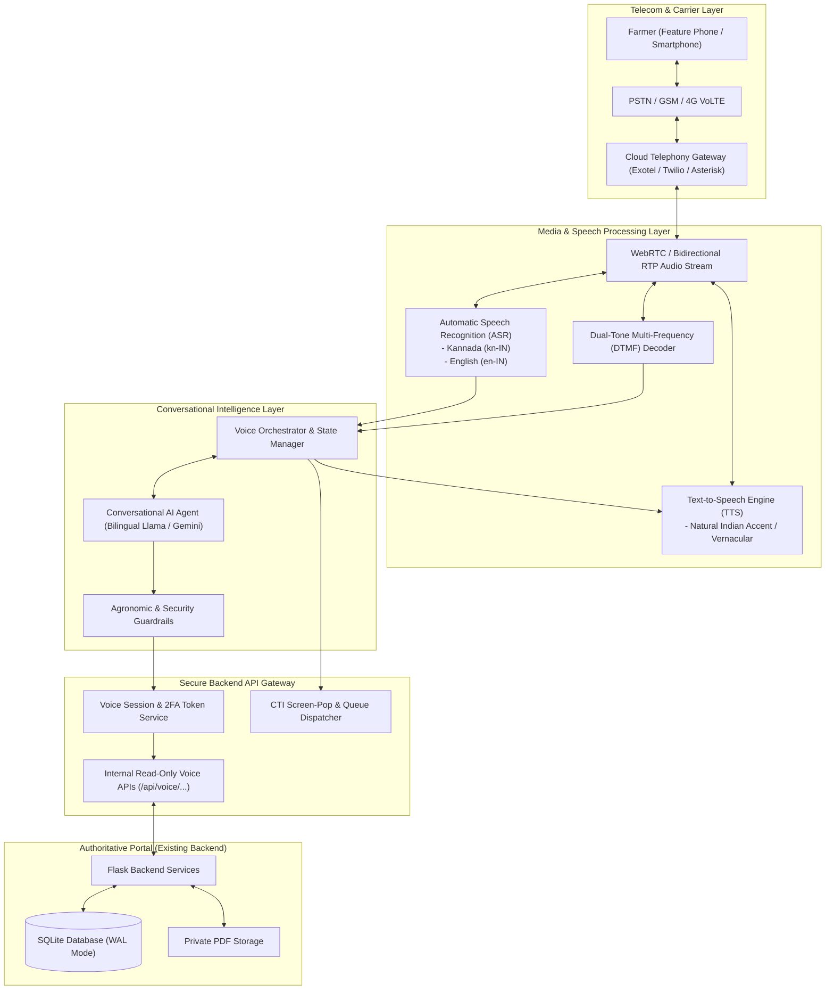
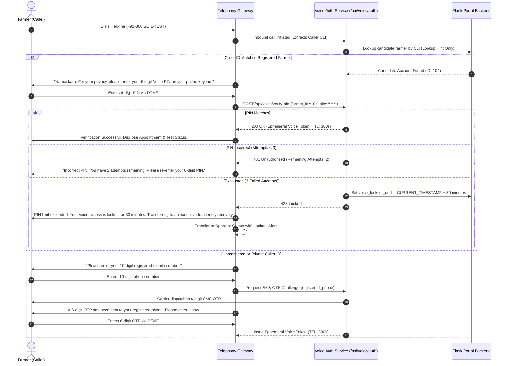

# Voice Assistant & Phone-Service Integration Specification
## Soil Testing Appointment & Report Access Portal
### Future Milestone: Voice Services (Post-Milestone Phase)

> **Document Version:** 2.1.0 (Formal Deferral Revision)  
> **Status:** Formally Deferred to `Future Phase — Voice Services` (Post-Milestone)  
> **Implementation Scope:** Non-Active Specification. All voice assistant, telephony gateway, IVR, Voice PIN, CTI screen-pop, and conversational AI features are excluded from active implementation milestones (Phases 8–11). This document preserves the architectural and security specifications for future implementation after the core web and postal workflows are operational. The current website's language and authentication functionality remain unchanged.

---

> [!IMPORTANT]
> **Roadmap Status Notice:** This milestone is **formally deferred**. The active implementation roadmap strictly prioritizes:
> 1. **Phase 8:** Staff Foundation and Assisted Registration
> 2. **Phase 9:** Field Operations and Sample Tracking
> 3. **Phase 10:** Laboratory Operations and Report Authorization
> 4. **Phase 11:** Physical Printing and Postal Delivery
> 
> No telephony or voice features will be built or integrated during Phases 8–11. Call-centre operators handle incoming telephone calls as standard human conversations and operate directly through the secure operator web portal interface.

---

## 1. Executive Summary & Rural Telephony Context

In rural Karnataka and agricultural belts across India, smartphone penetration and high-speed broadband are unevenly distributed. A significant portion of smallholder farmers rely on basic 2G feature phones, voice calls, or community kiosks. Navigating web forms with complex text inputs is an operational barrier.

To provide equitable access, the **Soil Testing Appointment & Report Access Portal** must support a **multilingual telephony gateway** that enables farmers to:
1. Inquire about soil test status using natural spoken Kannada (*ಕನ್ನಡ*) or English.
2. Schedule sample collection visits via telephone.
3. Receive automated voice updates when their soil sample moves from field collection to laboratory assay to postal delivery.
4. Seamlessly transfer to human call-centre operators with contextual caller verification.

### Core Security Mandate: Caller ID Non-Reliance
In public switched telephone networks (PSTN), **Caller Line Identification (CLI / Caller ID) cannot be trusted as an authentication credential**. Caller IDs can be spoofed using VoIP gateways, SIP trunking services, or PBX manipulation. 

**Architectural Rule:** Under no circumstances will private agricultural data, farmer contact addresses, or soil test results be disclosed solely on the basis of incoming Caller ID. A rigorous two-factor voice verification protocol is required.

---

## 2. Telephony & Conversational AI System Architecture

The telephony subsystem bridges standard PSTN/GSM voice channels with our existing Flask REST backend:



---

## 3. Strict Identity Verification Protocol (Anti-Spoofing & Six-Digit PIN)

To prevent social engineering, identity theft, and cross-farmer data leaks over the telephone, all inbound status inquiries must complete a **two-factor verification handshake**.

### 3.1 Verification Factors
1. **Factor 1 (Possession Hint):** Inbound phone number (Caller ID). Acts strictly as a directory lookup hint to identify candidate accounts. It never grants authentication on its own.
2. **Factor 2 (Secret Knowledge):**
   - **Six-Digit Voice PIN:** A 6-digit numeric PIN ($10^6$ combinations, e.g. `849201`) established by the farmer during web profile setup, operator onboarding, or via automated IVR keypress.
   - **Year of Birth is strictly removed** as an authentication fallback due to public availability and vulnerability to social engineering.
3. **Unregistered or Mismatched Caller ID:**
   - If the caller dials from a phone number not matching the registered account (e.g. calling from a relative's phone or public PCO):
   - The IVR prompts the caller to enter their 10-digit registered mobile number.
   - The system dispatches a real-time 6-digit SMS OTP to the registered phone number.
   - The caller inputs the SMS OTP via DTMF to establish identity.



### 3.2 Attempt Limits, Lockout & Human-Assisted Recovery
- **Attempt Limit:** A maximum of **3 consecutive failed PIN attempts** is permitted within a 15-minute sliding window.
- **Temporary Lockout:** Upon the third consecutive failure, the account's voice interface enters a **30-minute lockout**. During lockout, automated status readouts are disabled for that account.
- **Human-Assisted Recovery Protocol:**
  1. The caller is transferred to a human `operator`.
  2. The operator cannot see, set, or ask for the farmer's PIN directly.
  3. The operator initiates an **Identity Challenge**: the system automatically triggers a 6-digit high-entropy SMS OTP to the farmer's registered carrier phone number.
  4. The operator instructs the farmer: *"We have sent a verification code to your registered mobile. Please enter this code on your telephone keypad when the automated prompt sounds."*
  5. The operator transfers the call to an automated IVR sub-flow where operator audio is muted.
  6. The farmer keys in the 6-digit OTP. Once validated, the IVR prompts the farmer to enter a fresh 6-digit Voice PIN twice via DTMF.
  7. The call transfers back to the operator with a `PIN_RESET_CONFIRMED` status badge.

### 3.3 Zero Information Disclosure Prior to Verification
- **Strict Data Redaction Rule:** Prior to successful 6-digit Voice PIN or SMS OTP validation, the telephony system will **NEVER**:
  - Greet the farmer by full legal name (greetings use generic terms or first name only if explicitly permitted).
  - Reveal plot survey numbers, land acreage, or field landmarks.
  - Reveal sample IDs, laboratory chemical test values, or soil health parameters.
  - Disclose home postal addresses or Speed Post tracking consignment numbers.

---

## 4. Kannada & English Interactive Voice Dialog Flows

### 4.1 Language Selection & Main Menu

```text
[Call Connects - High quality 8kHz mono audio]
IVR: "Welcome to the Agricultural Soil Testing Helpline.
      ಕನ್ನಡಕ್ಕಾಗಿ 1 ಅನ್ನು ಒತ್ತಿರಿ. (Press 1 for Kannada).
      For English, press 2."

Farmer: [Presses 1 or says "ಕನ್ನಡ"]

IVR (Kannada): 
"ನಮಸ್ಕಾರ! ಮಣ್ಣು ಪರೀಕ್ಷೆ ಸೇವಾ ಕೇಂದ್ರಕ್ಕೆ ಸ್ವಾಗತ.
 - ನಿಮ್ಮ ಮಣ್ಣಿನ ಮಾದರಿಯ ಸ್ಥಿತಿಯನ್ನು ತಿಳಿಯಲು, 1 ಅನ್ನು ಒತ್ತಿರಿ.
 - ಹೊಸ ಮಣ್ಣು ಪರೀಕ್ಷೆ ಅಪಾಯಿಂಟ್‌ಮೆಂಟ್ ಕಾಯ್ದಿರಿಸಲು, 2 ಅನ್ನು ಒತ್ತಿರಿ.
 - ನಮ್ಮ ಸೇವಾ ಪ್ರತಿನಿಧಿಯೊಂದಿಗೆ ಮಾತನಾಡಲು, 9 ಅನ್ನು ಒತ್ತಿರಿ."

IVR (English):
"Welcome to the Soil Testing Service Centre.
 - To check the status of your soil sample, press 1.
 - To book a new soil testing appointment, press 2.
 - To speak with our customer service representative, press 9."
```

### 4.2 Multi-Stage Status Query Flow (Vernacular Translations)

The voice assistant translates underlying decoupled engineering statuses into simple, reassuring agricultural terminology:

```text
===================================================================================================================
UNDERLYING SYSTEM STATE             KANNADA VOICE RESPONSE                  ENGLISH VOICE RESPONSE
===================================================================================================================
appointment: Pending                "ನಿಮ್ಮ ಮಣ್ಣು ಪರೀಕ್ಷೆಯ ವಿನಂತಿಯನ್ನು     "Your appointment request has been received 
visit: Unassigned                   ಸ್ವೀಕರಿಸಲಾಗಿದೆ. ಶೀಘ್ರದಲ್ಲೇ ಕ್ಷೇತ್ರ         and is awaiting field worker assignment. 
                                    ಕಾರ್ಯಕರ್ತರನ್ನು ನಿಯೋಜಿಸಲಾಗುವುದು."          You will receive an update soon."

appointment: Approved               "ನಿಮ್ಮ ಭೇಟಿಯನ್ನು ಅನುಮೋದಿಸಲಾಗಿದೆ.       "Your visit is confirmed for [Date], 
visit: Assigned                     ದಿನಾಂಕ [Date] ರಂದು ಕ್ಷೇತ್ರ ಕಾರ್ಯಕರ್ತರು    [Morning/Afternoon]. Field officer 
                                    ನಿಮ್ಮ ಜಮೀನಿಗೆ ಭೇಟಿ ನೀಡಲಿದ್ದಾರೆ."         will visit your field."

visit: En Route                     "ಕ್ಷೇತ್ರ ಕಾರ್ಯಕರ್ತರು ನಿಮ್ಮ ಜಮೀನಿಗೆ      "The field officer is currently traveling 
                                    ಬರುತ್ತಿದ್ದಾರೆ. ದಯವಿಟ್ಟು ಹೊಲದಲ್ಲಿ ಹಾಜರಿರಿ." to your farm. Please be available at the plot."

sample: In Transit                  "ನಿಮ್ಮ ಮಣ್ಣಿನ ಮಾದರಿಯನ್ನು ಸಂಗ್ರಹಿಸಲಾಗಿದೆ.   "Your soil sample has been collected and is 
                                    ಅದು ಈಗ ಪರೀಕ್ಷಾ ಪ್ರಯೋಗಾಲಯಕ್ಕೆ             in transit to the regional testing laboratory."
                                    ತಲುಪುತ್ತಿದೆ."

lab: Testing In Progress            "ನಿಮ್ಮ ಮಣ್ಣಿನ ಮಾದರಿಯು ಪ್ರಯೋಗಾಲಯದಲ್ಲಿದೆ.   "Your sample is in the lab. Chemical testing 
                                    ಸಾರಜನಕ, ರಂಜಕ, ಪೊಟ್ಯಾಶ್ ಮತ್ತು pH        for N-P-K and pH is currently in progress."
                                    ರಾಸಾಯನಿಕ ಪರೀಕ್ಷೆ ನಡೆಯುತ್ತಿದೆ."

report: Digitally Published         "ನಿಮ್ಮ ಮಣ್ಣು ಪರೀಕ್ಷಾ ವರದಿ ಸಿದ್ಧವಾಗಿದೆ.     "Your soil test report is complete. Your soil 
                                    ನಿಮ್ಮ ಜಮೀನಿನ pH ಮೌಲ್ಯ [X.X] ಆಗಿದೆ.      pH is [X.X]. You can view the full certificate 
                                    ಪೂರ್ಣ ವರದಿಯನ್ನು ವೆಬ್ ಪೋರ್ಟಲ್‌ನಲ್ಲಿ        on the web portal or request postal delivery."
                                    ನೋಡಬಹುದು."

dispatch: Dispatched                "ನಿಮ್ಮ ಮುದ್ರಿತ ಮಣ್ಣು ಆರೋಗ್ಯ ಕಾರ್ಡ್ ಅನ್ನು    "Your printed Soil Health Card has been 
(Speed Post)                        ಸ್ಪೀಡ್ ಪೋಸ್ಟ್ ಮೂಲಕ ಕಳುಹಿಸಲಾಗಿದೆ.         dispatched via Speed Post. Consignment number 
                                    ಟ್ರ್ಯಾಕಿಂಗ್ ಸಂಖ್ಯೆ [EK123456789IN]."     is [EK123456789IN]."

dispatch: Delivered                 "ನಿಮ್ಮ ಮಣ್ಣಿನ ವರದಿಯು ನಿಮ್ಮ ವಿಳಾಸಕ್ಕೆ     "Your soil health card has been successfully 
                                    ತಲುಪಿದೆ. ಸಲಹೆಗಾಗಿ ನಮ್ಮ ತಜ್ಞರನ್ನು ಸಂಪರ್ಕಿಸಿ." delivered to your home address."
===================================================================================================================
```

---

## 5. Escalation to Human Call-Centre Operator (CTI Screen-Pop)

When a farmer selects option `9` or when conversational AI detects repeated misunderstandings:
1. The telephony server places the caller on brief hold with calming instrumental music.
2. The Computer Telephony Integration (CTI) gateway routes the call to the next available `operator`.
3. **Screen-Pop Protocol:** The operator's browser interface instantaneously opens a verified caller modal:
   - Farmer Name: `Ramesh Patel`
   - Verified Mobile: `+919876543210`
   - Authentication Status: `Verified via 6-digit Voice PIN`
   - Active Booking: `Appointment #42 (Survey No 88, Someshwar Village)`
   - Current Status: `Laboratory Testing In Progress (N-P-K & pH)`
4. The operator greets the farmer without forcing them to repeat their name or appointment number, significantly reducing average handling time (AHT) and increasing farmer satisfaction.

---

## 6. Conversational AI Architecture & Agronomic Guardrails

For conversational self-service (answering general agricultural queries about soil health, sampling methods, or understanding pH), an LLM-based voice agent is deployed with **strict defensive boundaries**.

### 6.1 Safe Tool Calling Architecture
The conversational agent interacts with the portal through **scoped, read-only internal APIs** with zero direct database write permissions:

```text
===================================================================================================================
TOOL NAME                           PARAMETERS                      API ENDPOINT CALLED
===================================================================================================================
get_appointment_status              voice_token, appointment_id     GET /api/voice/appointment-status
get_sampling_guidelines             language ('kn' | 'en')          GET /api/voice/sampling-protocol
request_operator_callback           voice_token, reason             POST /api/voice/callback-request
get_soil_ph_explanation             ph_value (float)                GET /api/voice/ph-advisory
===================================================================================================================
```

### 6.2 Agronomic Guardrails (Defensive Policy)

> [!CAUTION]
> **Zero Chemical Hallucination Rule:** An AI conversational agent must NEVER synthesize or guess chemical fertilizer dosage (such as Urea, DAP, or Potash quantities) without reading a verified, scientifically approved laboratory report.

#### Mandatory System Prompt Guardrails
```text
YOU ARE: "Manna Siri" (ಮಣ್ಣ ಸಿರಿ), an AI agricultural assistant for the Soil Testing Portal.
LANGUAGE: You speak fluent, respectful, rural-friendly Kannada and Indian English.

STRICT SAFETY CONSTRAINTS:
1. NEVER recommend specific synthetic chemical fertilizer dosages (kg/acre of Urea, DAP, MOP) 
   unless quoting directly from a verified laboratory report returned by the 'get_appointment_status' tool.
2. If a farmer asks "How much urea should I add?", respond:
   "ನಿಮ್ಮ ಮಣ್ಣಿನ ಅಧಿಕೃತ ಪ್ರಯೋಗಾಲಯ ಪರೀಕ್ಷಾ ವರದಿ ಬರುವವರೆಗೆ ಯಾವುದೇ ರಾಸಾಯನಿಕ ಗೊಬ್ಬರದ ಪ್ರಮಾಣವನ್ನು 
    ಶಿಫಾರಸು ಮಾಡಲು ಸಾಧ್ಯವಿಲ್ಲ. ಪರೀಕ್ಷೆಯ ಫಲಿತಾಂಶದ ಆಧಾರದ ಮೇಲೆ ಕೃಷಿ ತಜ್ಞರ ಸಲಹೆ ಪಡೆಯಿರಿ."
   ("No chemical fertilizer quantity can be recommended until your official lab test report is ready. 
    Please follow certified recommendations once laboratory testing is complete.")
3. In all sampling advice, explain that exact sampling depths and preparation steps must follow the 
   guidelines established by the local agricultural department or testing laboratory.
4. If the caller asks about topics unrelated to agriculture, soil health, crops, or appointment status, 
   politely redirect them to soil testing services.
```

---

## 7. Outbound Automated Notifications & Privacy

1. **Visit Scheduled Notification:**
   - Trigger: Admin assigns field worker (`field_visits.visit_status = 'Assigned'`).
   - Action: 30-second automated voice call 24 hours prior to visit date informing the farmer of the arrival window and requesting that the field plot be accessible.
2. **Sample Intake Acknowledgment:**
   - Trigger: Laboratory scans sample barcode (`soil_samples.sample_status = 'Received'`).
   - Action: Automated SMS confirming safe arrival at the testing laboratory.
3. **Report Ready & Dispatch Notification:**
   - Trigger: Speed Post consignment entered (`report_dispatches.dispatch_status = 'Dispatched'`).
   - Action: Automated notification delivering the Speed Post tracking number and expected delivery window.
4. **Voice Privacy & Audit Trail:**
   - Every call begins with: *"This call may be recorded for quality and service purposes."*
   - Telemetry logs (`voice_call_audit_logs`) record call durations, timestamps, hashed caller IDs, and verification statuses. Plaintext audio recordings are stored in encrypted private storage subject to institutional data retention policies.